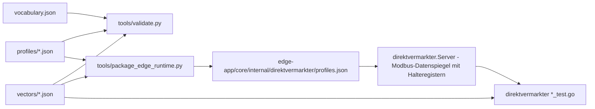

# Direktvermarkter

Je Direktvermarktungspartner ein **Partnerprofil**: Zugangsweg, Registerbild, Fristen, Vertragslink und
Einrichtungsschritte, mit Testvektoren für den Go-Zwilling auf der Box. Grundlage ist das Konzept
„Kunden verbinden ihre Anlage selbst mit luox und weiteren Direktvermarktern“ (vp-direktvermarktung-konzept,
Fassung d2, 25.11.2026, entschieden E1-E6 = A), hier Stufe 1 seines Abschnitts 9: Vertrag und Schnittstelle.

**Ein Profil ist Vertrag, keine Steuerung.** Was der Partner höchstens kann, steht im Registerbild selbst
(lesen, eine Prozentvorgabe und ein Lebenszeichen schreiben); nichts an der Box erlaubt mehr. Die Form folgt
Abschnitt 5.3 des Konzepts unverändert, bis auf das Feld `quellen`, das die dortige Beispielform nicht trägt und
hier darum auch nicht eingeführt wird.



## Aufbau

| Pfad | Inhalt |
|---|---|
| `profiles/<partner>.json` | ein Profil je Partner, die einzige von Hand gepflegte Wahrheit |
| `vocabulary.json` | Registerbedeutungen (Fassung 1), für spätere Partner vorgesehene Bedeutungen, Einrichtungsschritte, die offenen Fragen F1-F18 |
| `vectors/<partner>.json` | Testvektoren für den Go-Zwilling: Dekodieren/Kodieren je Wortfolge, rohe Modbus-Telegramme (FC 3/4/6/16, Band-Verstoß, unbekannte Adresse, Lebenszeichen), Lebenszeichen-Ablauf, veraltete Werte; trägt auch die vorläufigen Laufzeit-Annahmen für die noch offenen Fragen F3 und F8 |
| `schema/profile.schema.json` | JSON-Schema des Profils |
| `tools/validate.py` | Schema plus Projekt-Invarianten |
| `tools/package_edge_runtime.py` | erzeugt die Box-Sicht für den Go-Core (`--check` im CI) |

## Offene Fragen bleiben offen

Ein Wert, den luox noch nicht bestätigt hat, trägt die Frage, von der er abhängt: ganz offen als
`"offen (Fxx)"` (z. B. die Wortfolge, F3) oder mit einem vorläufigen Wert als `"<wert> (Fxx)"`
(z. B. `"vorgabe_wirkt_auf": "einspeisung_netzpunkt (F5)"`). `validate.py` prüft, dass jede so markierte
Frage tatsächlich in `vocabulary.json` steht. Die Box kann mit `"offen (Fxx)"` nicht laufen; für die beiden
Fragen, die den Betrieb selbst betreffen (F3 Wortfolge, F8 Verhalten bei veralteten Werten),
trägt `package_edge_runtime.py` den vorläufigen Wert ein, den auch die Testvektoren verwenden
(`wortfolge_laufzeit`, `bei_veraltet_laufzeit` in `vectors/<partner>.json`) - ein Wechsel, sobald luox
antwortet, ändert nur diesen einen Wert, nie den Code. Für F5 und F6 (Referenzgröße) trägt die gepackte
Sicht nur die Basis ohne Fragenanhang, weil diese Stufe die Vorgabe noch nicht auswertet (siehe unten).

## Was die Box bekommt - und was nicht

`package_edge_runtime.py` schreibt `edge-app/core/internal/direktvermarkter/profiles.json`: das volle
Registerbild (Tabelle, Adresse, Typ, Bedeutung, Band) und die Modbus-Zugangsdaten (Unit, Wortfolge,
Funktionen, Verbindungen), weil der Datenspiegel-Server sie zum Betrieb braucht - anders als die
Steuerprofile, die dem Gerät bewusst keinen Hebel geben. Was diese Stufe (1 · Vertrag und Schnittstelle)
noch nicht auswertet, bleibt draußen: OpenVPN, der Vertragslink, die Einrichtungsschritte und
`vorgabe_wirkt_auf`/`referenz` (die erst mit der Verdrahtung in `composeCurtailment` in Stufe 2 etwas
bedeuten). Eine wissens-only-Änderung (Name, Vertragstext, Einrichtungsschritte) lässt die gepackte
Sicht bytegleich.

## Prüfen

Nur Standardbibliothek, ohne Netz- oder Gerätezugriff (der JSON-Schema-Evaluator ist der des
Messpunktkatalogs):

```bash
python3 catalog/direktvermarkter/tools/validate.py
python3 -m unittest discover -s catalog/direktvermarkter/tests -p 'test_*.py'
python3 catalog/direktvermarkter/tools/package_edge_runtime.py --check
```

Dazu `go test ./internal/direktvermarkter/...` in `edge-app/core` (eingebettete Kopie gegen den Katalog,
Dekodieren/Kodieren und rohe Telegramme gegen `vectors/*.json`).

## Ändern

1. Profil unter `profiles/` bearbeiten; eine neue Registerbedeutung zuerst in `vocabulary.json` eintragen.
2. `validate.py` ausführen, dann `package_edge_runtime.py` ausführen - das ist eine Box-Änderung und
   gehört zu einem Edge-Release.
3. Ändert sich eine Wortfolge, ein Band oder eine Registeradresse, auch `vectors/<partner>.json`
   nachführen; `go test ./internal/direktvermarkter/...` schlägt sonst fehl.
4. Beantwortet luox eine Frage, den betroffenen Wert in `profiles/<partner>.json` auf den bestätigten Wert
   setzen (Marker entfernen) und, falls es F3 oder F8 war, denselben Wert in `vectors/<partner>.json`
   (`wortfolge_laufzeit`/`bei_veraltet_laufzeit`) - erst dann `package_edge_runtime.py` erneut ausführen.
