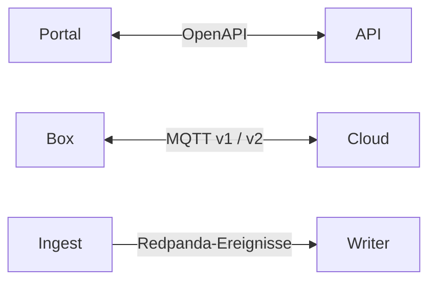

# Schnittstellenverträge

JSON-Schemas und OpenAPI beschreiben die gemeinsamen Grenzen zwischen Portal, API, Cloud und Box. Änderungen am Vertrag müssen mit Produzenten, Konsumenten und Fixtures kompatibel sein.

## Nachschlagen

| Grenze | Referenz |
|---|---|
| HTTP-API | [openapi.yaml](openapi.yaml) |
| v1-Telemetrie / Ereignis | [MQTT](mqtt-telemetry.schema.json), [telemetry.raw](telemetry-raw.event.schema.json) |
| v1-Fahrplan | [mqtt-schedule](mqtt-schedule.schema.json) |
| Status-Herzschlag: Steuerstand des Speichers | [Vertrag](speicher-steuerstand.md), [Vektoren](speicher-steuerstand-vectors.json) |
| Status-Herzschlag: Ladequelle je Säule (Echo für „Box hat übernommen“) | [Vertrag](ladepunkt-quelle-echo.md), [Vektoren](ladepunkt-quelle-echo-vectors.json) |
| Vorsprung mit Bestand je Anlage (api → Optimierer, Vorsprung-Budget NS-2 A) | [Vertrag](steuerung-vorsprung-v1.md), Tabelle `steuerung_vorsprung` |
| Provisioning | [Hello-/Config-Vertrag](mqtt-provisioning.schema.json) |
| Kennung einer Box (`edge-` + Prüfzeichen; Box, API und Portal) | [Vektoren](edge-ref-vectors.json) |
| v2: Entitäten, Flows, Verbraucher und Messpunkte | [v2-Übersicht](v2/README.md) |
| Energetische Bewertung (UEMS AP-16) | [Regeln](v2/bewertung.md), [Regel-Vektoren](v2/bewertung-vectors.json), [Messabdeckung Ahrenberg](v2/messabdeckung.json), [Schema](v2/bewertung.schema.json) |
| Bezugsbasis einer Kennzahl (UEMS AP-17) | [Regeln](v2/bezugsbasis.md), [Regel-Vektoren](v2/bezugsbasis-vectors.json), [Schema](v2/bezugsbasis.schema.json) |
| Ziele, Maßnahmen, Abweichungen (UEMS AP-18) | [Regeln](v2/verbesserung.md), [Regel-Vektoren](v2/verbesserung-vectors.json), [Schema](v2/verbesserung.schema.json) |
| Energiemanagement: Überprüfung, Wiedervorlage, Verzeichnis-Zeile (UEMS AP-19) | [Regeln](v2/energiemanagement.md), [Regel-Vektoren](v2/energiemanagement-vectors.json), [Schema](v2/energiemanagement.schema.json); Managementbewertung als [Vorlage Nr. 7](v2/bericht-vorlagen.json) im [Berichtsvertrag](v2/bericht.md), Rolle „Einsicht“ in der [Rechte-Matrix](v2/rechte-matrix.json), Herkunft der Maßnahme in [verbesserung.md](v2/verbesserung.md) |
| OCPP-Ereignisse und Befehle | [Ereignis](mqtt-ocpp-events.schema.json), [Command](mqtt-ocpp-command.schema.json) |
| OTA | [Manifest](ota-release-manifest.schema.json) mit [Vektoren je Box-Art](ota-release-manifest-vectors.json), [Signatur](ota-signature.schema.json), [Ziel](mqtt-ota-target.schema.json) |
| Ladepark | [Konfiguration](mqtt-charging-config.schema.json), [Boost](mqtt-charging-boost.schema.json) |
| Registerbild Erzeuger: Steuerung einer PV- oder BHKW-Anlage → Box (Modbus, nur lesen) | [Vertrag](v2/erzeuger-registerbild.md), [Vektoren](v2/erzeuger-registerbild-vectors.json), [Schema](v2/erzeuger-registerbild.schema.json); Energiekarten: [WAGO-Registerbild](v2/wago-registerbild.md) |
| Box-Quelle der Anlagensteuerung: Registry-Treiber und Pin (UEMS EZ-21) | [Regel](v2/edge-entity.schema.json) `x-anlagensteuerung-driver-rule`, [Vektoren](v2/anlagensteuerung-quelle-vectors.json), Fähigkeit `anlagensteuerung_quelle` ([Herzschlag](v2/edge-supports.md)) |
| Diagnose / Eingriff | [Probe](mqtt-probe.schema.json), [Registerauftrag](mqtt-register-write.schema.json), [Datenbereinigung](mqtt-data-purge.schema.json) |
| Fernwartung | [Soll-Stand des Tunnel-Dienstes](fernwartung-soll-v1.example.json), Routen im OpenAPI-Tag `fernwartung`; [Schlüsselausgabe an die Box](fernwartung-schluessel-v1.md) mit [Vektor](fernwartung-schluessel-v1.example.txt); [Rückmeldung des Tunnel-Dienstes ans Portal](fernwartung-rueckmeldung-v1.md) mit [Vektor](fernwartung-rueckmeldung-v1.example.json) |
| Werkstatt: Prüfungen der Werkstatt-Regel für die Abnahme einer Box (API und Portal) | [Vektor](werkstatt-pruefungen.json), Routen im OpenAPI-Tag `werkstatt`, [Werkstatt](../werkstatt.md) |
| Werkstatt: Beschriftung des Gehäuses, Referenz und QR-Code mit dem Direktlink (Portal und Gehäuse-Programm) | [Vektor](werkstatt-beschriftung.json), [Gehäuse](../../edge-light/gehaeuse/glinet-gl-mt300n-v2/docs/kennung.md) |
| Beispiele | [v1-Fixtures](examples/README.md), [v2-Fixtures](v2/examples/README.md) |

Die Dateien in diesem Verzeichnis sind die vollständige Schemaablage; die Tabelle gruppiert die wichtigsten Grenzen.

## Versionsregeln

Versionen gehören zum jeweiligen Vertrag. Ein neuer v2-Plattformvertrag kann mit `schema_version: "1.0"` beginnen. Bestehende v1-Geräte müssen weiterhin bedient werden; v2-Themen leben getrennt unter `ems/{tenant}/{site}/{device}/v2/…`.

Breaking Changes ausdrücklich versionieren. Neue optionale Felder dürfen alte Konsumenten nicht beschädigen. Bekannte semantische Abweichungen nicht durch unbemerkte Schemaänderungen „bereinigen“: siehe [Netzladen-Default](v2/mqtt-schedule-2.0.md#netzladen).

Schema-Prüfung ergänzt, ersetzt aber keine semantischen Tests zu Identität, Grenzen, TTL, RLS oder tatsächlicher Gerätewirkung.
