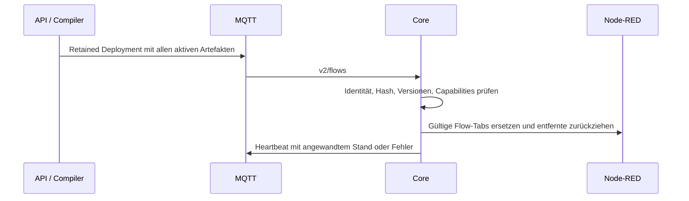

# Flow-Artefakt und Auslieferung

Verbindlich: [flow-artifact.schema.json](flow-artifact.schema.json). Ein kompiliertes Artefakt enthält Manifest und Bündel (Node-RED-Tabs oder eine Steuerlogik); die Cloud verteilt den vollständigen gewünschten Artefaktbestand je Box.

## Manifest

- Identität: `artifact_id`, `flow_id`, `flow_version`, `runtime`.
- `content_hash`: SHA-256 über JCS-kanonisiertes `bundle`. Core prüft vor Anwendung.
- `min_palette_version`, `min_core_version`: benötigte Laufzeitversionen; eine nicht passende Box meldet `unsupported`.
- `required_entities`: benötigte Entitäten und Fähigkeiten; eine leere Liste der Fähigkeiten heißt, die Box muss die Entität nur kennen. Fehlende Voraussetzung verhindert dieses Artefakt, keine teilweise Anwendung innerhalb eines Flows.
- Ein reserviertes `signature`-Feld ist nicht mit der implementierten OTA-Release-Signaturkette gleichzusetzen.

## Bundle und Bestand

Format `nodered-tabs`; deterministische Tab-/Knoten-IDs ermöglichen Ersetzen statt Duplizieren. Artefakt-Tabs tragen `@vp-flow flow_id=… flow_version=…`. Unterstützte Knoten einschließlich Funktions-/Modbus-Ausnahmen stehen im [Graphvertrag](flow-graph.md#katalogausnahmen).

### Steuerlogik

Format `steuerlogik` ([Steuerlogik](steuerlogik.md#auslieferung-und-mitlauf)): `bundle = {format: "steuerlogik", logic: "<kanonisches JSON als Text>", site?: {timezone, latitude, longitude}}`, keine Felder des Node-RED-Formats daneben.
Die Logik ist ein String, kein Objekt: der Hash kanonisiert Objekte mit sortierten Schlüsseln, die Reihenfolge der Zustände ist aber die Reihenfolge der Auswertung - nur als Text steht sie unter dem Hash.
`site` ist der Ort der Anlage für Uhrzeit, Tageswechsel und Sonnenstand; fehlt die Lage, bleibt der Sonnenstand unbekannt.
Gebaut wird es nur vom Logik-Dienst; die Cloud liefert es nur an eine Box mit `steuerlogik_mitlauf`.
Beide Box-Arten geben es an den Kern im Programm, nie an Node-RED oder den Verbraucherregel-Zwilling; das Tor `min_palette_version` gilt für dieses Format nicht, `min_core_version` und `required_entities` gelten.
Eine Box ohne den Kern quittiert `unsupported` („Steuerlogik läuft auf dieser Box nicht“), eine ältere Box das unbekannte Format als `error`.
Beispiel: [flow-artifact.valid.steuerlogik.json](examples/flow-artifact.valid.steuerlogik.json) (gepinnt vom Dienst).

Budget: 256 KiB je Artefakt, 512 KiB je serialisiertem Deployment gemäß Schema-Anmerkungen. Größere Payloads nicht still in einen ungeprüften Downloadpfad auslagern.

`ems/{tenant_id}/{site_id}/{device_id}/v2/flows`: QoS 1, retained. Die Liste ist vollständiger Sollbestand, kein Patch. Leeres `artifacts` zieht alle Artefakt-Tabs zurück und stoppt jede mitlaufende Steuerlogik. Ungültige Artefakte melden `error`/`unsupported`; andere gültige Einträge können weiterhin angewandt werden.

Der Core persistiert Artefakte und aktualisiert Node-RED über dessen Admin-API. Zurückgezogene Wünsche laufen entsprechend ihrer TTL aus; der nächste gültige Besitzer beziehungsweise Failsafe übernimmt.

**Edge Light** hat kein Node-RED. Dort führt das Programm dasselbe Artefakt selbst aus, wenn es nur aus generierten Verbraucherregeln besteht (`vp-consumer-policy` mit seinen `inject`-Auslösern): der Go-Zwilling `internal/verbraucherregel` liest dieselben Topics des lokalen Busses und sendet denselben Wunsch wie der Palette-Knoten ([Vektoren](verbraucherregel-vectors.json)). Er steht beim Tor `min_palette_version` für den Palette-Stand 0.5.0. Jedes andere Node-RED-Bündel, etwa eine Automation aus dem Flow-Editor, quittiert Edge Light als `unsupported` mit dem Grund; eine [Steuerlogik](#steuerlogik) läuft im Kern beider Box-Arten. Ein unverändertes Artefakt läuft mit seinem Zustand weiter, ein geändertes startet neu, ein zurückgezogenes hört auf zu erneuern.

## Reseed und Bestätigung

Reseed erhält markierte `@vp-flow`-Tabs und erneuert die Herstellervorlagen getrennt. Die alte Behauptung, jeder Templatewechsel ersetze zwangsläufig alle Kundenflows, beschreibt nicht mehr den aktuellen Pfad.

Heartbeat-`flows.applied` enthält Flow-ID, Version, Hash und Zustand. Konvergenz liegt erst vor, wenn der passende Stand als angewandt gemeldet ist. Das Cloud-Soll allein genügt nicht.

Rücknahme veröffentlicht den vollständigen Bestand mit dem früheren Artefakt erneut. Belege: Core-`internal/flowdeploy`, Node-RED-Reseed und [v2-Prüfstand](edge-simulator-v2.md).
