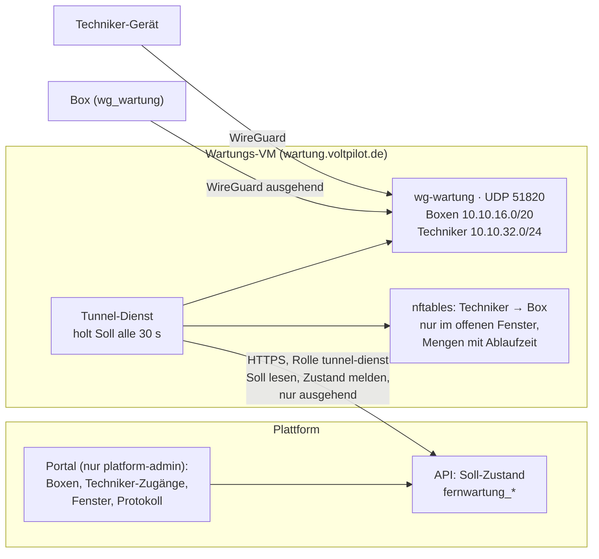

# Fernwartung: Wartungstunnel über das Portal

Der Wartungstunnel der VoltPilot-Boxen wird im Portal verwaltet. Das Portal führt den **Soll-Zustand**; ein kleiner **Tunnel-Dienst** auf einer eigenen VM holt ihn regelmäßig ab und setzt ihn auf WireGuard und nftables um. Die Plattform schreibt nie selbst auf den Server. Der Dienst meldet dem Portal zurück, welche Box verbunden ist und welches Fenster seinen Schlüssel abgeholt hat; das ist Anzeige und ändert am Soll-Zustand nichts ([Rückmeldung](#rückmeldung-des-tunnel-dienstes)).

Grundlage sind die Entscheide des Kapitäns vom 07.10.2026:

- **E5:** Fernwartung über das Portal verwalten.
- **Endpunkt:** ein neuer Name auf einer eigenen kleinen VM (Vorgabe `wartung.voltpilot.de`, konfigurierbar). Dort läuft WireGuard ohne Weboberfläche plus der Tunnel-Dienst; Techniker bekommen dort eigene Zugänge. **`vpn.voltpilot.de` mit WireGuard UI bleibt unberührt.**
- **O3:** Der Kunde stimmt der Fernwartung einmal generell zu (Vertrag/AGB) und sieht die einzelnen Zeitfenster nicht. Intern wird jedes Fenster mit Grund, Techniker und Zeit protokolliert.



## Netze und Server

| Einstellung | Vorgabe | API (`voltpilot.fernwartung.*`) |
|---|---|---|
| Box-Netz, Server auf `.1` | `10.10.16.0/20` | `box-netz` / `VP_FERNWARTUNG_BOX_NETZ` |
| Techniker-Netz, Server auf `.1` | `10.10.32.0/24` | `techniker-netz` / `VP_FERNWARTUNG_TECHNIKER_NETZ` |
| Längstes Fenster | 24 h (Datenbank-Grenze 7 Tage) | `max-fenster-dauer` / `VP_FERNWARTUNG_MAX_FENSTER_DAUER` |
| Servername | `wartung.voltpilot.de` | `server-endpunkt` / `VP_FERNWARTUNG_SERVER_ENDPUNKT` |
| UDP-Port | `51820` | `server-port` / `VP_FERNWARTUNG_SERVER_PORT` |
| Öffentlicher Server-Schlüssel | leer, bis die VM steht | `server-public-key` / `VP_FERNWARTUNG_SERVER_PUBLIC_KEY` |

Der Servername zeigt direkt auf die öffentliche Adresse des Servers (kein HTTP-Proxy davor: WireGuard ist UDP), und die VM hat eine feste Adresse, an der eine Portweiterleitung hängen kann. Der Tunnel-Dienst sichert nur den Verkehr durch den Tunnel; eine eigene Firewall der VM richtet er nicht ein ([Installation](../services/tunnel-dienst/README.md#installation-auf-der-vm)).

Beide Netze überschneiden sich nicht mit dem alten Service-VPN `10.10.1.0/24`; ein Techniker-Gerät kann in beiden VPNs zugleich hängen. Die Netze müssen mit der Konfiguration des Tunnel-Dienstes übereinstimmen, sonst verwirft er den Soll-Stand. Ein widersprüchliches Netz bricht den Start der API ab.

## Datenmodell

Migrationen `V20261007163700__fernwartung.sql`, `V20261008213500__fernwartung_zugang_loeschen.sql`, `V20261009074500__fernwartung_ssh_schluessel.sql` und `V20261010203000__fernwartung_rueckmeldung.sql`; plattformweite Betriebsdaten ohne `tenant_id`.

| Tabelle | Inhalt |
|---|---|
| `fernwartung_zugang` | ein WireGuard-Peer: `art` `box` (mit `edge_ref`) oder `techniker` (mit `name`); öffentlicher Schlüssel und `/32`-Adresse, beide über **beide Arten** eindeutig; `status` `aktiv`/`gesperrt`, für Techniker-Zugänge zusätzlich `geloescht`; für Techniker-Zugänge wahlweise `ssh_public_key`, nicht eindeutig |
| `fernwartung_fenster` | Box, Techniker, Grund, Beginn, Ende, wer geöffnet und wer geschlossen hat; zusammengesetzte Fremdschlüssel erzwingen „Box“ und „Techniker“ |
| `fernwartung_protokoll` | jede Änderung, append-only per Trigger und ohne `UPDATE`/`DELETE`-Recht |
| `fernwartung_dienst_abruf` | wann welcher Tunnel-Dienst den Soll-Stand zuletzt abgeholt hat |
| `fernwartung_rueckmeldung_dienst`, `…_box`, `…_fenster` | was der Tunnel-Dienst zuletzt gemeldet hat: je Dienstkonto, je Box (verbunden seit, zuletzt gefragt), je Fenster (Schlüssel abgeholt), jeweils mit der Zeit, zu der die API es angenommen hat. Nur der letzte Stand, kein Verlauf |

- **O3 an der Datenbankgrenze:** Die App-Rolle hat auf keine dieser Tabellen ein Recht; RLS ohne Policy ist der zweite Riegel. Geschrieben und gelesen wird nur über `voltpilot_admin`.
- **Die Tabellen der Rückmeldung stehen für sich.** Sie verweisen auf Box und Fenster, aber weder der Soll-Stand noch eine Regel der Fernwartung liest sie ([Rückmeldung](#rückmeldung-des-tunnel-dienstes)).
- **Keine Zeile wird entfernt, keine Adresse neu vergeben.** Eine Adresse und ein Schlüssel bleiben ihrem Zugang, gesperrt wie gelöscht. Eine wiedervergebene Adresse ließe einen Techniker bei einem fremden Gerät landen. Die Admin-Rolle hat auf keiner Tabelle ein `DELETE`-Recht.
- **„Löschen“ ist ein Zustand, kein `DELETE`.** Ein gelöschter Techniker-Zugang trägt `status = 'geloescht'`; seine Zeile hält Adresse und Schlüssel über die `UNIQUE`-Constraints fest, und Fenster wie Protokoll verweisen weiter auf sie. Ein Trigger macht den Zustand endgültig: gelöscht wird nur aus `gesperrt`, und eine gelöschte Zeile ändert sich nie wieder. Eine Box kann den Zustand nicht annehmen (`CHECK`).

## Routen und Rollen

| Route | Rolle | Zweck |
|---|---|---|
| `/api/v1/admin/fernwartung/**` | `platform-admin` | Boxen, Techniker-Zugänge, Fenster, Protokoll, Übersicht |
| `GET /api/v1/fernwartung/soll` | `tunnel-dienst` | Soll-Stand für den Tunnel-Dienst |
| `PUT /api/v1/fernwartung/rueckmeldung` | `tunnel-dienst` | der Dienst meldet seinen Zustand: nur Anzeige ([Rückmeldung](#rückmeldung-des-tunnel-dienstes)) |

Das Dienstkonto ist der Keycloak-Client `voltpilot-tunnel-dienst` (nur `client_credentials`) im Muster von `voltpilot-release-publisher`. Seine Routen liegen bewusst **nicht** unter `/api/v1/admin/**`: Die Rückfallregel des Admin-Baums lässt nur `platform-admin` und `edge-release-publisher` durch, und das soll so bleiben. Kunden-, Publisher- und Admin-Token bekommen auf beiden Routen 403. Die Rolle hat damit genau ein Schreibrecht, und es umfasst genau diese Meldung. Vertrag: [OpenAPI](contracts/openapi.yaml), Tag `fernwartung`.

## Regeln

- **Schlüssel entstehen auf dem Gerät.** Hier kommen nur öffentliche Schlüssel an: WireGuard für Boxen und Techniker, dazu der SSH-Schlüssel des Technikers ([Anmeldung an der Box](#anmeldung-an-der-box-fenster-schlüssel)).
- **Box-Schlüssel hinterlegen** (`PUT …/boxen/{ref}/schluessel`) ist der Übergang bis zur Werkstatt-Registrierung D2; D2 soll genau diese Regel aufrufen.
  - Neu: Adresse aus dem Box-Netz zuteilen.
  - Derselbe Schlüssel noch einmal: unverändert.
  - Ein anderer Schlüssel: nur mit `schluesselTausch: true`. WireGuard verschiebt die Adresse dann zum neuen Peer.
  - Referenz wie bei der Kopplung: `edge-` mit Prüfzeichen, sonst muss die Plattform die Referenz kennen.
- **Fenster:** Box, Techniker-Zugang, Grund (3–500 Zeichen) und Dauer sind Pflicht.
  - Dauer höchstens `max-fenster-dauer`; Beginn jetzt oder bis 30 Tage im Voraus.
  - Ein überlappendes Fenster für dasselbe Paar wird abgelehnt: erst schließen, dann neu öffnen.
  - Vorzeitig schließen jederzeit; ein geplantes Fenster wird damit abgesagt.
- **Sperren** einer Box oder eines Zugangs schließt deren offene und geplante Fenster. Der Tunnel-Dienst entfernt den Peer beim nächsten Abruf.
- **Löschen** (`DELETE …/techniker/{id}`) gibt es nur für einen **gesperrten Techniker-Zugang**; ein aktiver muss erst gesperrt werden (409). Es ist endgültig.
  - Der Zugang fehlt danach in jeder Liste, Auswahl und Zählung des Portals und lässt sich nicht mehr entsperren; jede Route antwortet für ihn mit 404.
  - Seine Adresse und sein Schlüssel bleiben dauerhaft vergeben. Wer denselben Schlüssel noch einmal einträgt, bekommt 409 mit dem Hinweis, auf dem Gerät ein neues Schlüsselpaar zu erzeugen.
  - Das Protokoll bekommt den Eintrag `techniker_geloescht` mit Zeit und Akteur. Frühere Fenster- und Protokolleinträge bleiben lesbar und nennen den Zugang weiter beim Namen.
  - Für den Tunnel-Dienst ändert sich nichts: Schon der gesperrte Zugang stand nicht mehr im Soll-Stand.
  - Boxen lassen sich nicht löschen.

## Anmeldung an der Box (Fenster-Schlüssel)

Ein offenes Fenster öffnet den **Netzweg** zur Box. Die **Anmeldung** an der Box ist eine zweite Schranke: Ihr SSH-Server im Tunnel (Dropbear, Port 2222) lässt nur hinein, wessen öffentlicher Schlüssel auf der Box liegt. Entscheid des Kapitäns vom 09.10.2026: Der Techniker hinterlegt seinen öffentlichen SSH-Schlüssel einmal im Portal; solange ein Fenster offen ist, holt sich die Box ihn über den Wartungstunnel und behält ihn nur bis zum Ende des Fensters.

| Schritt | Inhalt | Stand |
|---|---|---|
| 1 | Portal und API: der SSH-Schlüssel steht am Techniker-Zugang und geht im Soll-Stand mit | umgesetzt |
| 2 | Tunnel-Dienst: gibt einer Box die Schlüssel der Techniker aus, für die gerade ein Fenster zu ihr offen ist | umgesetzt; auf der Wartungs-VM seit dem 09.10.2026 eingeschaltet (`10.10.32.1:8022`) |
| 3 | Box (`service-tunnel.sh`): holt die Schlüssel ab, hält sie nur im Arbeitsspeicher und führt die Frist selbst | umgesetzt für OpenWrt mit Dropbear ab 2025.89 (Mango, 25.12); eine Box holt erst ab, wenn ihr Tunnel mit diesem Skript eingerichtet ist |
| 4 | Rückmeldung des Tunnel-Dienstes ans Portal: Box verbunden, zuletzt gefragt, Schlüssel abgeholt | umgesetzt ([Rückmeldung](#rückmeldung-des-tunnel-dienstes)); wirkt, sobald Portal und Tunnel-Dienst beide auf diesem Stand laufen |
| 5 | Regeln: Werkstatt-Regel (Root-Passwort, Anmeldeprobe über Portal und Tunnel), ein Notfall-Schlüssel als einziger dauerhafter Schlüssel | beschrieben in [mango.md](../edge-light/docs/mango.md#bevor-eine-box-die-werkstatt-verlässt); je Box vom Kapitän umzusetzen, an keinem Gerät ausgeführt |

Die Schritte 1 bis 3 sind ausgerollt und am 10.10.2026 vom Kapitän an der Labor-Mango abgenommen ([Belege](../edge-light/docs/mango.md#belegt)).

**Eine Box holt nur ab, wenn zwei Dinge stimmen:** Ihr Tunnel ist mit dem `service-tunnel.sh` ab Schritt 3 eingerichtet, und die Schlüsselausgabe läuft am Wartungsserver. Fehlt eines davon, gelingt die Anmeldung wie vorher nur mit einem Schlüssel, der schon auf der Box liegt. Das Portal verspricht die Anmeldung deshalb nicht pauschal. Seit der Rückmeldung zeigt es am offenen Fenster, ob die Box den Schlüssel abgeholt hat, und nennt sonst den Grund, den die Meldung hergibt: Die Box fragt gar nicht nach Schlüsseln, oder die Schlüsselausgabe ist aus. An einer Box zeigt `service-tunnel.sh <ziel> status`, ob sie eingerichtet ist und wann der Server zuletzt geantwortet hat.

**Die Schlüsselausgabe des Tunnel-Dienstes** (Schritt 2): Eine Box fragt im Tunnel die Server-Adresse im Techniker-Netz (`10.10.32.1`, eigener Port) und bekommt die Schlüssel der Paare, die gerade in der Kernel-Menge `fenster` stehen, mit deren Restlaufzeit. Der Dienst prüft jeden Schlüssel noch einmal selbst, antwortet nur Box-Adressen und gibt ohne frisch abgeholten Soll-Stand keine Liste aus. Einzelheiten, Grenzen und das Einschalten auf der VM: [Tunnel-Dienst](../services/tunnel-dienst/README.md#schlüsselausgabe); Anfrage und Antwort für das Box-Skript: [Vertrag](contracts/fernwartung-schluessel-v1.md).

**Die Box-Seite** (Schritt 3, [mango.md](../edge-light/docs/mango.md#fenster-schlüssel-auf-der-box)): `service-tunnel.sh` legt einen Abholer, ein Startskript und eine cron-Zeile auf die Box. Geprüft mit echter SSH-Anmeldung durch einen echten Tunnel in `edge-light/test/wartung-anmeldung-probe.sh`.

- **Der Abholer fragt nur durch den Tunnel**, mit `uclient-fetch`. Führt die Route zum Server nicht über die Tunnel-Schnittstelle, fragt er nicht; eine Regel in der Firewall der Box weist die Anfrage auf jedem anderen Weg zusätzlich ab.
- **Die Schlüsseldatei liegt nur im Arbeitsspeicher**, in einem eigenen tmpfs, das allein die SSH-Instanz im Tunnel liest (`dropbear -D`). Ein Neustart der Box löscht jeden Fenster-Schlüssel.
- **Die Frist läuft in Laufzeit der Box, nicht in Uhrzeit.** Ohne gültige Antwort kommt nichts dazu, und was da ist, verfällt zur Frist: auch ohne Server und auch, wenn der Abholer hängt (ein cron-Lauf je Minute streicht unabhängig von ihm).
- **Die Antwort ist die ganze Liste.** Ein Schlüssel, den sie nicht mehr nennt, ist sofort gestrichen: bei vorzeitig geschlossenem Fenster und bei einem im offenen Fenster ersetzten oder entfernten Schlüssel.
- **Dauerhafte Schlüssel:** Was in `/etc/dropbear/authorized_keys` der Box steht, gilt im Tunnel weiter; das Skript liest die Datei nur. Solche Schlüssel umgehen die Schranke „kein Fenster, kein Schlüssel“: Öffnet ein Fehler der Server-Firewall den Port, kommt damit hinein, wer so einen Schlüssel hat. Entschieden (K2 a, 08.10.2026): In der Pilotphase bleibt auf jeder Box genau einer, ein Notfall-Schlüssel des Kapitäns, getrennt aufbewahrt; nach einigen Monaten Betrieb wird neu entschieden. Zielzustand und der Weg dorthin je Box: [mango.md](../edge-light/docs/mango.md#dauerhafte-schlüssel-ein-notfall-schlüssel).
- **SSH 2222 kommt nur aus dem Tunnel an** (Entscheid vom 09.10.2026). Die Box weist den Port auf jedem anderen Weg ab, ob der Tunnel oben ist oder unten. Port 22 im LAN ändert sich nicht.

- **Der Schlüssel am Zugang** (`sshPublicKey` beim Anlegen, `PUT`/`DELETE …/techniker/{id}/ssh-schluessel`) ist freiwillig. Ohne ihn öffnet ein Fenster für diesen Zugang nur den Netzweg; das Portal nennt das in der Zugangsliste, beim Öffnen eines Fensters und unter der Box, solange das Fenster offen ist.
- **Nur RSA, 2048 bis 4096 Bit.** Der Dropbear der Boxen (OpenWrt 25.12.5 auf der Mango) nimmt nur `ssh-rsa` an. Ein Ed25519-, ECDSA- oder FIDO-Schlüssel wird mit dem Befehl abgelehnt, der einen passenden erzeugt (`ssh-keygen -t rsa -b 3072`). 4096 Bit ist die größte Länge, mit der die Anmeldung an diesem Dropbear belegt ist.
- **Eine Zeile, keine Optionen davor.** Mehrzeiliges, ein privater Schlüssel und Optionen wie `command="…"` werden abgelehnt. Das Portal prüft dieselben Regeln schon im Browser; ein versehentlich eingefügter privater Schlüssel verlässt ihn nicht.
- **Gespeichert wird die Normalform** `ssh-rsa <Base64>`: ohne Kommentar, der Schlüssel neu kodiert. Dropbear vergleicht Bytes; nur die Normalform passt sicher zu dem, was der SSH-Client anbietet. Regeln: `SshSchluessel.java`, grob als `CHECK` in der Migration, im Portal `sshSchluesselPruefen`.
- **Der Fingerabdruck** ist der von `ssh-keygen -lf` (`SHA256:…`). Das Portal zeigt ihn am Zugang und nennt den Befehl zum Vergleich; im Protokoll steht nur er, nie der Schlüssel.
- **Nicht eindeutig.** Zwei Zugänge desselben Technikers dürfen denselben SSH-Schlüssel tragen. Wer im Box-Log unterscheiden will, welches Gerät sich angemeldet hat, gibt jedem Gerät einen eigenen.
- **Protokoll:** `techniker_ssh_schluessel_gesetzt` (mit neuem und vorherigem Fingerabdruck) und `techniker_ssh_schluessel_entfernt`; beim Anlegen steht der Fingerabdruck im Eintrag `techniker_angelegt`. Derselbe Schlüssel noch einmal ändert nichts und steht nicht im Protokoll.
- **Sperren und Löschen** ändern den Schlüssel nicht. Ein gesperrter oder gelöschter Zugang steht nicht im Soll-Stand, sein SSH-Schlüssel also auch nicht.
- **Befehle im Portal.** Der Dialog am Zugang nennt die Befehle zum Erzeugen für Windows (PowerShell) und Linux/macOS, mit dem Dateinamen `id_rsa_voltpilot`, damit kein vorhandener Schlüssel überschrieben wird. Unter einer Box mit offenem Fenster stehen die fertigen Befehle, je Fenster mit dem Satz, ob der Zugang einen SSH-Schlüssel trägt: `ssh -i ~/.ssh/id_rsa_voltpilot -p 2222 root@<Box-Adresse>` und für die Web-App der Box dieselbe Anmeldung mit `-L 8484:127.0.0.1:8484`, danach `http://127.0.0.1:8484` im eigenen Browser.

### Was mit einer laufenden Anmeldung geschieht

Eine Anmeldung, die im offenen Fenster begonnen hat, endet mit dem Fenster, weil der Wartungsserver den Weg trennt. Seine Firewall prüft **jedes** Paket gegen die Kernel-Menge `fenster`, in beiden Richtungen; steht das Paar nicht mehr darin, kommt nichts mehr durch.

| Fall | Was den Weg trennt | Wann | Belegt |
|---|---|---|---|
| Fenster im Portal geschlossen | der Tunnel-Dienst nimmt das Paar beim nächsten Abruf aus der Menge | spätestens ein Abrufintervall (30 s) nach dem Schließen | `integration.sh`, Schritt 3; `wartung-anmeldung-probe.sh`, Schritt 4 (echte SSH-Sitzung) |
| Fenster abgelaufen | der Kernel lässt das Element ablaufen, auch ohne Dienst und API | zum Ende des Fensters | `integration.sh`, Schritt 4 |
| Dienst auf der VM angehalten | zunächst nichts: Der Dienst baut beim Beenden nichts ab, das Fenster bleibt bis zu seinem geplanten Ende offen, und die Sitzung läuft so lange weiter. Dann trennt der Kernel | zum geplanten Ende des Fensters | `wartung-anmeldung-probe.sh`, Schritt 5 |

- **Solange der Dienst steht, wirkt ein Schließen im Portal nicht.** Es wirkt erst, wenn er wieder abholt, spätestens aber zum geplanten Ende des Fensters. Das Portal sagt es in der Zeile „Tunnel-Dienst holt nicht mehr ab“.
- **Getrennt heißt: nicht mehr benutzbar, aber noch nicht beendet.** Der Client des Technikers merkt es an seinem eigenen Lebenszeichen (`ssh -o ServerAliveInterval=5 -o ServerAliveCountMax=2` endet nach rund 10 s), sonst hängt er. Auf der Box bleibt der Anmeldeprozess stehen, bis Dropbear nach drei unbeantworteten Lebenszeichen aufgibt (`-K 300`: 15 Minuten nach dem letzten Paket, im Log `Keepalive timeout`). So war es bei der Abnahme am 10.10.2026: Fenster-Schlüssel gestrichen 17:40:38, Prozess beendet 17:55:37 (UTC).
- **Die Box beendet keine Sitzung.** Sie streicht den Fenster-Schlüssel, und das verhindert jede neue Anmeldung. Eine Sitzung, die vorher begann, hängt allein an der Firewall des Wartungsservers. Fehlt dessen Tabelle nach dem Ende des Fensters (`nft flush ruleset`; mit laufendem Dienst bis zu ein Abrufintervall, bei angehaltenem Dienst dauerhaft, siehe [Betrieb](../services/tunnel-dienst/README.md#nftables-neu-laden-oder-stoppen)), kommt eine solche Sitzung wieder durch. In der Probe ist das als Befund festgehalten (Schritt 5: Die Sitzung läuft in der Lücke weiter, eine neue Anmeldung wird abgewiesen). Ob die Box beim Streichen eines Fenster-Schlüssels auch die Sitzungen dieses Schlüssels beenden soll, liegt dem Kapitän zur Entscheidung vor; gebaut ist es nicht.

**Wer das Portal verwaltet, verwaltet damit die Anmeldung.** Sobald die Boxen Fenster-Schlüssel abholen, genügt ein Konto mit der Rolle `platform-admin`, um als root auf eine verbundene Box zu kommen: Zugang mit eigenem Schlüssel anlegen, Fenster öffnen. Vorgesehen sind deshalb ein zweiter Faktor für Portal-Administratoren vor der ersten Kundenbox auf diesem Weg und, vorgemerkt, vom Portal signierte Freigaben. Beides ist nicht umgesetzt.

## Web-App der Box im Fenster

Entscheid des Kapitäns vom 09.10.2026: Die Web-App der Box (Port 8484) ist im offenen Fenster für **jeden** Techniker frei, nicht mehr je Techniker-Adresse. `service-tunnel.sh` gibt sie beim Einrichten des Tunnels für das ganze Techniker-Netz frei.

- **Die Schranke ist allein das Fenster am Wartungsserver.** Die Box prüft nur, dass ein Paket durch den Tunnel und aus dem Techniker-Netz kommt. Wer es ist und ob ein Fenster offen ist, prüft sie nicht. Einzelheiten und die engere Wahl: [mango.md](../edge-light/docs/mango.md#was-die-box-im-tunnel-selbst-prüft).
- **Die Web-App hat keine Anmeldung.** Anders als bei SSH gibt es hier keine zweite Schranke. Ein Konto mit der Rolle `platform-admin` genügt damit schon heute, um die Web-App einer verbundenen Box zu bedienen: Zugang anlegen, Fenster öffnen.
- **Im Browser des Technikers:** `http://<Box-Adresse>:8484`, solange das Fenster offen ist. Das Portal nennt bisher nur den Weg über `ssh … -L 8484:127.0.0.1:8484`; er funktioniert weiter und braucht die Anmeldung an der Box.
- **Eine Box, deren Tunnel vor dem 09.10.2026 eingerichtet wurde,** bekommt die Freigabe, wenn die Befehlszeile aus dem Portal noch einmal läuft. Der Lauf fasst den Tunnel nicht an, wenn sich an ihm nichts ändert.

## Entscheide zum Betrieb (09.10.2026)

Nach dem Gesamttest mit der Labor-Box hat der Kapitän entschieden:

| Punkt | Entscheid | Stand |
|---|---|---|
| SSH zur Wartungs-VM | aus `192.168.0.0/24` und `192.168.178.0/24` erlaubt, sonst von nirgends | Regel in `/etc/nftables.d/vm-firewall.nft` auf der VM; am 09.10. aus beiden Netzen geprüft |
| Web-App 8484 im Tunnel | im offenen Fenster für alle Techniker | Box-Seite umgesetzt ([oben](#web-app-der-box-im-fenster)) |
| Paket `nftables` auf der VM | von den automatischen Updates ausgenommen, wird von Hand aktualisiert | `/etc/apt/apt.conf.d/53vp-nftables-von-hand` auf der VM |
| Labor-Mango `edge-5t2dcy6` | bleibt als Test-Box am Wartungsserver | verbunden, `10.10.16.2` |
| SSH 2222 der Box außerhalb des Tunnels | die Box weist es ab, auch im LAN und auch bei Tunnel unten | Box-Seite umgesetzt (`service-tunnel.sh`, eigene Firewall-Kette); gilt für eine Box, sobald das Skript erneut läuft |

**`nftables` von Hand aktualisieren.** Das Paket startet bei einer Aktualisierung `nftables.service` neu. Das leert den ganzen Regelsatz und schließt offene Fenster, bis der Tunnel-Dienst sie wieder öffnet ([Betrieb](../services/tunnel-dienst/README.md#betrieb)). `unattended-upgrades` übergeht deshalb `nftables` und die versionsgleiche Bibliothek `libnftables1`; alle anderen Sicherheitsupdates laufen weiter von selbst. Von Hand, wenn kein Fenster offen ist:

```bash
vp-tunnel-dienst status          # Offene Fenster: 0
apt update && apt install --only-upgrade nftables libnftables1
vp-tunnel-dienst status          # Firewall-Basis stimmt: ja
```

## Soll-Stand

`GET /api/v1/fernwartung/soll` liefert Version 1, Vektor: [`fernwartung-soll-v1.example.json`](contracts/fernwartung-soll-v1.example.json).

- `peers`: alle aktiven Zugänge mit `art`, `id`, `kennung`, `publicKey`, `adresse`. Gesperrte und gelöschte Zugänge stehen nicht darin.
- `sshPublicKey` an einem Techniker-Peer: sein öffentlicher SSH-Schlüssel in Normalform. Das Feld steht nur dort, wo einer hinterlegt ist; sonst fehlt es ganz, an einer Box immer. Für WireGuard und die Firewall spielt es keine Rolle.
- `fenster`: nur die **jetzt** offenen Fenster, deren Box und Techniker aktiv sind. Sie verweisen über `boxId`/`technikerId` auf Peers.
- Geplante Fenster stehen bewusst nicht darin. Der Dienst öffnet nur, was ein frisch abgeholter Stand jetzt verlangt.

Den Vektor lesen beide Seiten: `FernwartungRegelnTest` (Java) prüft die Felder der Serialisierung, der Tunnel-Dienst liest ihn in seinem Test streng ein.

**Der Soll-Stand wächst nur additiv, die Version bleibt 1.** Im Betrieb überliest der Dienst Felder, die er nicht kennt; sein Test liest den Vektor dagegen streng. Ein neues Feld braucht deshalb Vektor, Java-Test und Go-Struktur in derselben Änderung. Vor dem Ausliefern des Portals belegt `services/tunnel-dienst/test/vertraeglichkeit.sh <commit>`, dass der Stand, der gerade auf der VM läuft (`vp-tunnel-dienst version`), den heutigen Vektor genauso umsetzt wie ohne die neuen Felder. Für `sshPublicKey` ist das mit dem Stand `db32a784ce55` belegt: Das Portal darf vor dem Tunnel-Dienst ausgeliefert werden.

## Rückmeldung des Tunnel-Dienstes

Entscheid des Kapitäns (K3 a, 08.10.2026): Der Tunnel-Dienst darf dem Portal Rückmeldung geben, nur Zustandsangaben, über eine eigene Route. Damit sieht der Techniker im Portal, **warum** er nicht hineinkommt. Vertrag mit Vektor: [`fernwartung-rueckmeldung-v1.md`](contracts/fernwartung-rueckmeldung-v1.md); Seite des Dienstes: [Tunnel-Dienst](../services/tunnel-dienst/README.md#rückmeldung-ans-portal).

**Was der Dienst meldet, und sonst nichts:** je Box „verbunden seit“ und „zuletzt gefragt um“, je Fenster „Schlüssel abgeholt um“; dazu, seit wann er läuft und ob er Schlüssel ausgibt. Kein Schlüssel, kein Fingerabdruck, keine Adresse: Box und Fenster sind nur über die `id` benannt, die das Portal selbst vergeben hat.

| Angabe | Woran der Dienst sie festmacht |
|---|---|
| verbunden | der letzte WireGuard-Handshake der Box ist höchstens 3 Minuten alt |
| zuletzt gefragt | die Box hat die Schlüsselausgabe aufgerufen. Das tut nur eine Box mit dem `service-tunnel.sh` ab Schritt 3 |
| Schlüssel abgeholt | die Box hat in einer späteren Anfrage den Prüfwert der Liste genannt, die den Schlüssel enthält. Das tut sie erst, nachdem sie die Liste geprüft und in ihre Schlüsseldatei geschrieben hat |

**Was das Portal daraus zeigt,** an jeder Box (Spalte „Verbindung“, auf der Box-Seite in der Karte „Fernwartung“) und an jedem offenen Fenster, immer mit dem Alter der Angabe („Stand: vor 20 s“):

| Am offenen Fenster | Wann |
|---|---|
| Alles bereit | die Box ist verbunden und hat den Schlüssel abgeholt |
| Schlüssel noch nicht abgeholt | die Box ist verbunden, der Schlüssel fehlt ihr noch. Der Satz nennt den Grund: Sie fragt und bekommt ihn gleich; sie hat nie gefragt (Tunnel mit einem älteren Skript eingerichtet); die Schlüsselausgabe am Wartungsserver ist aus |
| Box nicht verbunden | der Dienst meldet die Box ohne Handshake in den letzten 3 Minuten. Das Fenster ist offen, aber niemand erreicht die Box |
| Kein SSH-Schlüssel am Zugang | am Techniker-Zugang steht keiner. Das weiß das Portal selbst, mit und ohne Meldung |
| Stand unbekannt | keine Meldung, eine veraltete, oder die letzte nennt Box oder Fenster nicht |

- **Unbekannt ist kein „nicht verbunden“.** Kam nie eine Meldung (auf dem Wartungsserver läuft ein Dienst ohne Rückmeldung), ist die letzte älter als 3 Minuten (VM oder Dienst nicht erreichbar) oder nennt sie die Box nicht, sagt das Portal genau das. Bei einer veralteten Meldung nennt es, was damals galt, als Vergangenes. Die Regeln: `adminFernwartung.ts` (`rueckmeldungLage`, `boxVerbindung`, `boxAnmeldung`).
- **Die Seite holt den Stand alle 20 s neu,** solange sie sichtbar ist. Nach dem Öffnen eines Fensters steht dort bis zur nächsten Meldung „Stand unbekannt“, danach folgt die Zeile ohne Zutun.
- **Das Alter misst die API.** Sie hält je Box und Fenster fest, wann sie die Meldung angenommen hat. Eine Meldung, deren Uhr um mehr als 5 Minuten von der der API abweicht, weist sie ab.
- **„Verbunden seit“ gleich dem Start des Dienstes** heißt: mindestens seit dann. Das Portal schreibt es so.

**Die Meldung ist Anzeige.** Sie fließt nie in den Soll-Stand zurück, aus dem der Dienst Peers, Fenster und Schlüsselausgabe ableitet:

- Die API hält sie in eigenen Tabellen; `FernwartungService` und `FernwartungRepository`, die den Soll-Stand bilden, kennen weder diese Tabellen noch die Klassen der Rückmeldung (`FernwartungRueckmeldungRegelnTest`).
- Gegen die laufende API belegt: Eine Meldung „nicht verbunden, nicht abgeholt“ lässt Soll-Stand, Zugänge, Fenster und Protokoll Byte für Byte unverändert (`FernwartungApiTest.dieRueckmeldungIstAnzeigeUndAendertDenSollStandNie`).
- Eine falsche Meldung kann im Portal etwas Falsches anzeigen. Einen Weg öffnen oder einen Schlüssel ausgeben lassen kann sie nicht.

**Die API prüft und begrenzt:** höchstens 2 MiB, streng gelesen (kein unbekanntes Feld), je Liste höchstens 10 000 Einträge, jede `id` eine UUID und nur einmal. Nennt die Meldung eine Box oder ein Fenster, das die API nicht kennt, wird sie als Ganzes abgewiesen (422) und nichts gespeichert.

**Die Rückmeldung stört die Arbeit des Dienstes nicht:** eigener Aufruf neben dem Abgleich, 5 s Frist, kein eigenes Token, keine Wiederholung. Scheitert er, laufen Soll-Stand, Firewall und Schlüsselausgabe unverändert weiter ([Tunnel-Dienst](../services/tunnel-dienst/README.md#rückmeldung-ans-portal)).

**VM und Cloud werden getrennt ausgerollt; jede Reihenfolge ist ohne Schaden:**

| Stand | Was geschieht |
|---|---|
| neue API, alter Dienst | es kommt keine Meldung. Das Portal zeigt „Tunnel-Dienst meldet keinen Zustand“ und an Box und Fenster „unbekannt“. Alles andere wie bisher |
| neuer Dienst, alte API | die Route gibt es nicht (404). Der Dienst schreibt es einmal als Hinweis ins Journal und fragt alle 10 Minuten wieder nach; Peers, Fenster und Schlüsselausgabe laufen wie bisher |
| beide neu | spätestens 10 Minuten nach dem zweiten Ausrollen (oder sofort nach einem Neustart des Dienstes) stehen die Angaben im Portal |

Empfohlene Reihenfolge: erst die Cloud (Migration, API, Portal), dann der Dienst auf der VM. Dann meldet der Dienst vom ersten Lauf an.

## Was das Portal weiß und was nicht

- **Weiß:** den Soll-Zustand und wann der Tunnel-Dienst ihn zuletzt abgeholt hat.
- **Weiß vom Tunnel-Dienst, mit Alter:** ob eine Box verbunden ist, wann sie zuletzt nach Schlüsseln gefragt hat und ob sie den SSH-Schlüssel eines Fensters abgeholt hat ([Rückmeldung](#rückmeldung-des-tunnel-dienstes)). Ein Fenster, das die Meldung nennt, steht in der Kernel-Menge des Servers.
- **Weiß nicht:** ob eine Anmeldung an der Box gelungen ist, und was ein Techniker dort tut. Das steht nur im Log der Box (`logread -e dropbear`), und das liegt im Arbeitsspeicher. Ebenso nicht, ob die Firewall des Servers gerade filtert: Auf der VM sagt es `vp-tunnel-dienst status` („Firewall-Basis stimmt“).
- **Fehlt die Meldung oder ist sie alt,** weiß das Portal über Boxen und Fenster nur den Soll-Zustand. Die Oberfläche benennt das, statt es zu überspielen. Auf der VM selbst zeigt `vp-tunnel-dienst status`, wann eine Box zuletzt nach Schlüsseln gefragt hat, und das Journal, welcher Schlüssel ihr ausgegeben wurde.

## Bausteine

- Tunnel-Dienst mit Installationsanleitung: `services/tunnel-dienst/`. Erste Einrichtung auf einer echten VM (Debian 13) am 08.10.2026; was dabei belegt wurde und was offen ist, steht dort unter „Prüfen“.
- Box-Seite und beaufsichtigter Wechsel des Piloten: `edge-light/openwrt/service-tunnel.sh`, `edge-light/docs/mango.md`. Proben: `edge-light/test/service-tunnel-probe.sh` (Einrichtung, OpenWrt 24.10) und `edge-light/test/wartung-anmeldung-probe.sh` (Anmeldung mit Fenster-Schlüsseln, OpenWrt 25.12).
