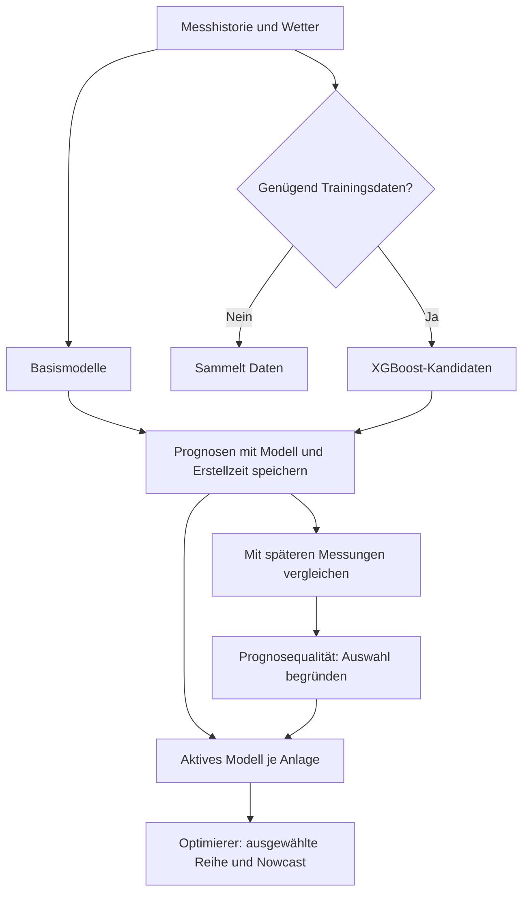

# Prognosen und Modellwahl

VoltPilot erzeugt mehrere Prognosereihen, verwendet für die Planung aber jeweils das ausgewählte Last- und PV-Modell. Kandidaten können parallel bewertet werden, ohne den laufenden Betrieb zu ändern.

## Modelle

| Modellkennung | Aufgabe |
|---|---|
| `load-persistence` | Last aus vorhandener Historie / Baseline |
| `pv-physical` | Physikalische PV-Prognose |
| `load-xgb` | Gelernte Lastprognose |
| `pv-residual-xgb` | Gelernte Korrektur der physikalischen PV-Prognose |
| `pv-physical-legacy-dni` | Dieselbe Physik mit der historischen, falsch gelesenen Direktstrahlung - reiner Vergleichs-Kandidat, siehe unten |

Trainingsvoraussetzungen und Defaults stehen in [Registry](../services/forecast/voltpilot_forecast/registry.py) und [ML](../services/forecast/voltpilot_forecast/ml.py). Ohne ausreichende Daten wird `collecting` mit Fortschritt gemeldet; der Kandidat liefert dann keine vorgetäuschte Prognose. Training und Bewertung verwenden den vorgesehenen Berlin-Tagesbezug.

### Die Direktstrahlung: Lesefehler N1 und sein Vergleichs-Kandidat (S0, 11.11.2026)

Open-Meteo liefert `direct_radiation` WAAGERECHT, nicht senkrecht zur Sonne; die senkrechte Größe heißt dort `direct_normal_irradiance` (die echte DNI). `pv-physical` las bis zum 11.11.2026 `direct_radiation` als DNI - bei niedrigem Sonnenstand (Winter) unterschätzte das den Ertrag um mehr als die Hälfte (Scout-Bericht `vp-prognosen-konzept`, Abschnitt 4.2). Der Captain hat den Lesefehler ausdrücklich beheben lassen ("Behebe den Lesefehler"), nicht nur im Schatten mitlaufen lassen:

- `pv-physical` liest seitdem `direct_normal_irradiance` (`OpenMeteoWeatherProvider(use_true_dni=True)`, `weather_forecast.dni_normal_w_m2`). Nichts an Modell-Id, Registry-Eintrag oder Auswahl-Mechanik ändert sich - nur die Eingangsgröße.
- `pv-physical-legacy-dni` rechnet mit derselben Physik weiter die ALTE, falsch gelesene Reihe (`weather_forecast.dni_w_m2`, unverändert) - für immer, als reiner Vergleichs-Maßstab ("alt gegen neu gegen gemessen"), bis die pauschale Verlustannahme (14 %) mit genug Messwerten geprüft werden kann.
- `pv-physical-legacy-dni` ist absichtlich NICHT in `KNOWN_MODELS`/`ForecastModels.known()`: sie kann nie als aktives Modell gewählt werden, weder über die Anlagen-/Plattform-Wahl noch über die Umgebungsvariable - das ist über den Vokabular-Zaun erzwungen, nicht nur vereinbart. Die tägliche Bewertung sieht sie trotzdem: `forecast_accuracy` gruppiert über die `kind`-Spalte der `forecast`-Tabelle, nie über diese Registry.
- `pv-residual-xgb` baut auf `pv-physical` auf (`physical + gelernter Rest`) und berechnet seine Basis bei jedem Training live neu - ein Neustart des Collectors (jedes Deployment) trainiert den Rest automatisch gegen die neue, korrigierte Basis; es gibt keine doppelte Korrektur, weil nirgends eine alte Basis zwischengespeichert wird.

Live wirkt der Fix erst mit einem Deploy, den firstmate mit dem Captain abstimmt.

## Auswahl und Rücknahme

Die wirksame Auswahl folgt dieser Reihenfolge:

1. Letzte Entscheidung der Anlage in `site_forecast_model_choice`.
2. Plattformvorgabe in `forecast_model_choice`.
3. `VOLTPILOT_ACTIVE_LOAD_MODEL` beziehungsweise `VOLTPILOT_ACTIVE_PV_MODEL`.
4. Basismodell der Registry.

Die Auswahl im Portal gilt nur für diese Anlage und wird append-only protokolliert. Ein späterer Env-Wechsel überschreibt sie nicht. Die API prüft auch serverseitig, ob ein Kandidat noch sammelt beziehungsweise ob eine Tagesbewertung vorliegt. Rücknahme erfolgt durch erneute Wahl eines verfügbaren Modells.

API, Collector und Optimierer müssen dieselbe Auswahl auflösen. Quellen: `ForecastModels`, `model_choice.py`, `inputs.py`.

## Qualität richtig lesen

Pro Viertelstunde zählt die jüngste Prognose, die **vor oder zum Slotbeginn** vorlag. Spätere Vorhersagen dürfen den Rückblick nicht verbessern.

| Kennzahl | Bedeutung |
|---|---|
| MAE | Mittlere absolute Abweichung in kW |
| nMAE | Normierte Abweichung; bei nicht sinnvoller Bezugsgröße unbekannt |
| Bias | Vorzeichenbehaftete mittlere Abweichung |
| Skill | Vergleich mit dem aktiven Modell dieser Anlage; positiv bedeutet besser |

Die historische Spalte `skill_vs_baseline` trägt weiterhin ihren Namen, obwohl die Referenz das aktive Modell sein kann. `plan_accuracy` vergleicht nur Slots mit den erforderlichen Plan-, Mess- und Preisdaten. Fehlende Daten sind keine Nullabweichung.

**Erwartung je Einheit (Anlagen-Check).** Derselbe tägliche Lauf wie `forecast_rueckblick` (`rueckblick.py`) teilt den Abend-Lauf je Viertelstunde nach dem physikalischen Anteil jeder bestätigten PV-Einheit (ihre Dachflächen, Wetter des Tages, ohne Wetter klarer Himmel) und legt die Tagessumme in `solar_erwartung_einheit` ab (`einheit_erwartung.py`). Die Einheiten summieren sich zur Tagessumme des Abend-Laufs; rückwirkend nur, solange `forecast` den Abend-Lauf hält (`rueckblick run --days-back`). Der Vergleich gegen die Messung (Regel „fällt ab“) ist `AnlagenCheckRegel` in der API.

## PV-Nowcast

Der Optimierer kann den nahen PV-Horizont anhand des jüngsten gemessenen Fehlers korrigieren. Diese begrenzte, abklingende Korrektur wird nicht unter dem Namen des ursprünglichen Prognosemodells zurückgeschrieben.

Daher misst `forecast_accuracy` die gespeicherte Modellprognose; die tatsächlich zur Planung verwendete Korrektur gehört in die Plandiagnose. Schalter und Grenzen: `OPTIMIZER_PV_ANCHOR_*` in [config.py](../services/optimization/voltpilot_optimization/config.py), Berechnung in [nowcast.py](../services/optimization/voltpilot_optimization/nowcast.py).

## Unsicherheit für „Sonne + Speicher“

Die Prognosen liefern keine Quantile. Die [Speicheruntergrenze](verbrauchssteuerung.md#sonne--speicher) liest deshalb gemessene Fehlerverteilungen der gespeicherten Prognosen, je Anlage und aktivem Modell, letzte 28 abgeschlossene Nächte beziehungsweise Tage:

| Reihe | Fehler je Nacht/Tag | Verwendet | Quelle |
|---|---|---|---|
| Last | `Σ gemessen / Σ prognostiziert − 1` der Nacht, Abendlauf 17:45 des Vortags | Q0,9 als Aufschlag | `night_reserve.night_error_quantiles` |
| PV | dasselbe über 06–21 Uhr Berlin, mindestens 51 der 60 Viertelstunden gepaart, Tage unter 1 kWh Prognose ausgelassen | Q0,1 als Abschlag | `storage_release.pv_day_error_quantiles` |

Beide Zahlen wirken nur in die vorsichtige Richtung. Unter sieben auswertbaren Nächten/Tagen gelten dokumentierte Vorgaben (+25 % / −30 %). Gemessen wird die gespeicherte Modellprognose, nicht die Planzeitkorrektur des Nowcasts. Reicht der Fahrplan nicht bis zur nächsten Erzeugung, liest die Untergrenze die frischen gespeicherten Läufe darüber hinaus; sind sie älter als `OPTIMIZER_STORAGE_RELEASE_FORECAST_MAX_AGE_MINUTES` (120), gibt es keine Freigabe.

## Der Lesepunkt (S1) und die Woche je Stunde (S4)

`GET /api/v1/sites/{siteId}/forecast` (report `vp-prognosen-konzept`, Abschnitt 9, E6 von „Preise und Wetter" vom 20.10.2026) ist der einzige Portal-Lesepunkt auf die gespeicherte Prognose - unabhängig davon, ob die Anlage einen Fahrplan hat. Er löst Sonne und Verbrauch je über das AKTIVE Modell dieser Anlage auf (dieselbe Präzedenz wie `/forecast-quality`) und liefert drei Teile:

- die 48-Stunden-Viertelstunden-Reihe des jüngsten Laufs (`pvKw`/`loadKw`, `pvRunAt`/`loadRunAt` - getrennt, nicht eine gemeinsame Zeit, weil ein ausgefallener Collector-Lauf einer Art sich nie in der Zeit der anderen verstecken darf);
- `yesterdayExpected`: die Reihe des Abendlaufs (17:45 ± 15 min Europe/Berlin) des Vortags, beschränkt auf dessen eigene Viertelstunden - dieselbe Abendlauf-Konvention wie `night_reserve`/`storage_release` (oben);
- `weekly`: der stündliche Ausblick aus S4, siehe unten.

`forecast` selbst trägt kein RLS (komprimiert, kann keins mehr bekommen - `ForecastTableDisciplineTest`); der Zaun ist `Geltungsbereich.requireSite` VOR der Query (`ForecastRepository.java`), dieselbe Code-Disziplin wie `SeriesRepository`/`EarningsRepository`/`AnteilVerlustRepository` - eine fremde Anlage ist 404.

**S4, die Woche je Stunde.** Ab „übermorgen" (Berlin-Mitternacht, zwei Kalendertage voraus - nicht ein rollendes 48h-Fenster) rechnet der Collector einen stündlichen Ausblick, solange echtes Wetter reicht (`WEATHER_FORECAST_DAYS=7` seit S4; vorher 3). Die Sonne kommt immer vom physikalischen PV-Modell (`pv-physical`, `physical.power_series`), der Verbrauch immer vom Tagestyp-Profil (`load-profile`, `ProfileLoadForecaster.values_at`) - NIE vom gewählten aktiven Modell der Anlage, weil der Ausblick ein eigenes Produkt ist, kein Schattenbetrieb-Kandidat. Gespeichert wird GETRENNT von der Viertelstunden-Prognose in `forecast_weekly` (Migration V20261111140000) - anders als `forecast` trägt diese Tabelle RLS (nicht komprimiert, die `weather_forecast`-Blaupause). `weekly_outlook_timestamps` (`forecast_collect.py`) liefert die Zeitpunkte; eine fehlende Reichweite (noch nicht genug Wetter) ist eine leere Liste, nie eine erfundene Zeile.

Die Kurzfrist-Korrektur bleibt bewusst unverändert: S1 zeigt die gespeicherte Prognose unkorrigiert für jede Anlage (die „einfachere Variante" aus dem Scout-Bericht, Abschnitt „Voraussetzungen und Grenzen" R.2) - dieselben reinen Nowcast-Funktionen (`nowcast.py`/`pv_nowcast.py`/`load_nowcast.py`) an einer Stelle für alle Anlagen anzuwenden bleibt eine spätere Entscheidung, kein Teil dieser Scheibe.

## Betrieb

[Forecast-Service](../services/forecast/README.md) nennt Start- und Testbefehle. Tabellen und Rechte werden über die API-Migrationen gepflegt. Modellwahl und Kundenauswertung sind mandantengebunden; Backend-Collector haben eigene Schreibzugänge.

Eine neue Modellidee ist erst verfügbar, wenn Registry, Datengrundlage, Trainings-/Bewertungsweg und Tests existieren. Automatische Beförderung wird durch dieses Dokument nicht zugesagt.
