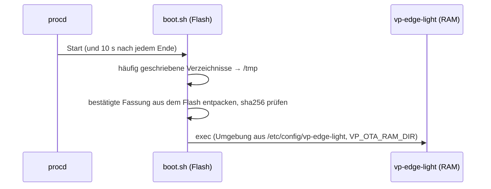
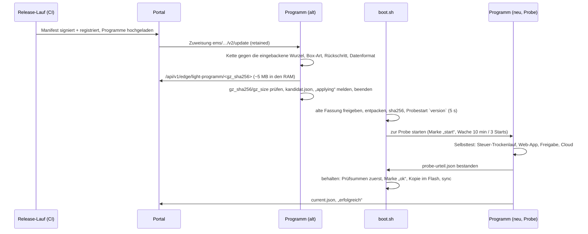

# Start aus dem RAM und Updates

Edge Light startet aus dem RAM und aktualisiert sich über das Portal wie die Docker-Box: Release wählen, Boxen ankreuzen, „Aktualisieren“ (Edge-Updates). Auf der Box ersetzt ein kleiner Tauschablauf im Loader den Updater-Container. Entschieden im Konzept `vp-edge-light-update` (U-1 bis U-6 jeweils A, 04.11.2026), gebaut in K1 bis K5.

## Start

- **Im Flash:** Loader, Dienst, Konfiguration, Wartungstunnel; **eine** bestätigte Fassung gepackt (`/usr/share/vp-edge-light/vp-edge-light-linux-<arch>.gz`) mit Prüfsummen-Datei (Zeile 1: Programm, Zeile 2: gepackte Kopie); unter `/etc/vp-edge-light/ota` Vertrauens-Set, `current.json` und die Marken der Versuche; die Box-Daten (Identität, Zertifikat, Auswahl, Freigaben).
- **Im RAM:** das laufende Programm (~16 MB), die häufig geschriebenen Verzeichnisse, unter `/tmp/vp-edge-light/ota` die Zuweisung und die Dateien eines laufenden Updates.
- Liegt nach einem Neustart des Dienstes genau die bestätigte Fassung noch im RAM, wird sie weiterverwendet. Vor dem Entpacken prüft der Loader den Speicher (40 MB `MemAvailable`, Seitencache wird einmal geräumt, [mango.md](mango.md)).
- Laden bei jedem Start (`base_url`) ist abgeschafft: Es lud ungeprüft. Ein gesetzter Wert wird ignoriert und gemeldet, `install.sh` entfernt ihn.

## Ein Update

1. **Release** (`edge-light-release.yaml`, Tag `edge-light-JJJJ.MM.N`): baut mipsle und arm64, packt sie (`gzip -9 -n`), erzeugt das Manifest (`vp-ota manifest --binary`), signiert es mit dem Release-Schlüssel der Docker-Box, prüft es gegen die eingebackene Wurzel, trägt es ins Register ein und lädt die Programme ins Portal (in Teilen, `ota_light_upload`). Nur mit der Repo-Variable `EDGE_LIGHT_SIGNIEREN=true` ([ota-signing.md](../../docs/ota-signing.md#box-arten-docker-box-und-edge-light)).
2. **Portal:** Ein Edge-Light-Release ist erst zuweisbar, wenn jedes Programm seines Manifests geprüft im Portal liegt. Die Zuweisung bleibt im Broker liegen; eine Box, die offline ist, holt sie später.
3. **Programm** (`edge-app/core/internal/agent/ota_light.go`, Regeln in `internal/otalight`): wendet nur an, was es selbst geprüft hat, nur mit einem Loader, der das Protokoll kennt (`VP_OTA_RAM_DIR`), und nur mit einem Programm für die eigene Plattform.
4. **Loader** (`boot.sh`): tauscht, wacht und nimmt zurück. Das Programm entscheidet nie, was in den Flash kommt.

### Dateien zwischen Programm und Loader

| Datei | Ort | schreibt | Inhalt |
|---|---|---|---|
| `target.json` | RAM | Programm | die retained Zuweisung |
| `kandidat.gz`, `kandidat.json` | RAM | Programm | geladene Fassung; Prüfsummen aus dem geprüften Manifest, Zuweisung, `state_schema` |
| `probe.json` | RAM | Loader | Fassung zur Probe, Frist (Laufzeit des Geräts), Starts |
| `probe-urteil.json` | RAM | Programm | bestanden / durchgefallen / offen mit Grund |
| `versuche` | Flash | Loader | `start\|ok\|zurueck\|abbruch <seq> <zuweisung> [grund]`, höchstens 40 Zeilen |
| `current.json` | Flash | Programm (Einrichtung: `install.sh`) | bestätigter Stand, `state_schema` |
| `trust-set.json(.sig)` | Flash | Einrichtung (`install.sh`) | root-signiertes Vertrauens-Set |

### Strom weg mitten im Update

| Wann | Was passiert |
|---|---|
| beim Laden | RAM leer → die bestätigte Fassung startet; die Zuweisung liegt noch im Broker → die Box lädt erneut |
| in der Probe | RAM leer → die bestätigte Fassung startet, der Loader schreibt „abbruch“. Nach zwei Abbrüchen gilt das Release als gescheitert |
| beim Schreiben in den Flash | Die neuen Prüfsummen stehen schon. Ist die Kopie unvollständig, lädt der Loader genau diese Fassung aus dem Portal nach und prüft sie. Ohne Internet startet das Programm erst wieder, wenn es da ist; der Tunnel läuft weiter |

## Nicht verhandelbar

| Nr. | Schicht | Umsetzung | belegt |
|---|---|---|---|
| 1 | Echtheit | Programm prüft Manifest und Signatur vor dem Laden; Loader startet aus dem RAM nur, was die sha256 aus `kandidat.json` trägt; in den Flash kommt nur Bestätigtes | `ota_light_test.go`, `boot-update-probe.sh` Fall 6, P10 |
| 2 | Passung | Manifest je Box-Art und Architektur; Probestart `version` mit 5 s Frist | Fall 2, P2 |
| 3 | Probezeit | 10 min für einen grünen Selbsttest **mit Cloud** (die Frist wacht im Loader) | Fall 4, 10, P4, P6 |
| 4 | Absturzschleife | 3 Starts in der Probe; Marke „start“ im Flash zählt Neustarts des Geräts | Fall 3, 7, P3, P8 |
| 5 | Zwei Orte | neue Fassung nur im RAM, bestätigte im Flash | Fall 1, 7, P7, P8 |
| 6 | Prüfsumme zuerst | Prüfsummen-Datei atomar vor der Kopie, Nachladen nach `gz_sha256` | Fall 8, P9 |
| 7 | Speicher | gepackt laden (~5 MB), entpacken erst nach dem Freigeben der alten Fassung, 40-MB-Schwelle, `GOMEMLIMIT`, `oom_score_adj` 800 | `boot-speicher-probe.sh`, P5 |
| 8 | Erreichbarkeit | ein Update tauscht nur das Programm; Loader, Dienst, Wartungstunnel (WireGuard, SSH 2222, Firewall, cron) ändert es nie | jeder Fall |
| 9 | Kein Drängeln | zurückgenommen = kein neuer Versuch ohne neue Zuweisung (anderes `assigned_at`) | `otalight_test.go`, P3 |
| 10 | Datenformat | anderes `state_schema` als bestätigt → nicht automatisch | `otalight_test.go` |

Die Fälle stehen in `edge-light/test/boot-update-probe.sh` (OpenWrt 25.12.5 im Container, alle Zweige des Loaders, einmal mit dem echten Programm). Der Nachweis am Gerät ist der [Laborbeweis P1–P11](../labor/README.md).

## Einrichten und Nachrüsten

- **Werkstatt:** `install.sh` legt Vertrauens-Set, bestätigte Fassung (Prüfsumme zuerst) und `current.json` aus dem signierten Manifest auf die Box. Die Abnahme verlangt die Prüfung **„Update-bereit“** ([werkstatt.md](../../docs/werkstatt.md)).
- **Boxen mit Stufe 1** (`edge-tgjn9gd`, Pilot `edge-zay5sdd`, VoltPilotGATE): einmal durch den Wartungstunnel mit demselben `install.sh`, vorher genauso an der Labor-Mango ([Nachrüsten](nachruesten.md)).
- Ein Update ändert Loader, Dienst und Tunnel-Skripte nie (Folgearbeit FA-2 im Konzept). Neue Fassungen davon kommen nur durch die Werkstatt oder den Tunnel.

## Versand (Entscheid 5c, U-6)

Boxen gehen erst zum Kunden, wenn der Laborbeweis P1–P11 vollständig grün ist **und** das erste echte Update über das Portal auf `edge-tgjn9gd` gelungen ist. Bis dahin bleibt der Satz „Nicht versenden“ in der Werkstatt stehen; danach wird er durch die Abnahme-Prüfung „Update-bereit“ ersetzt.
