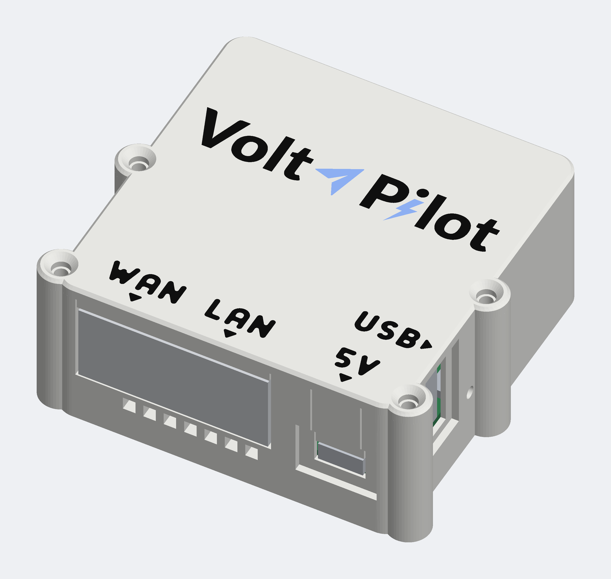
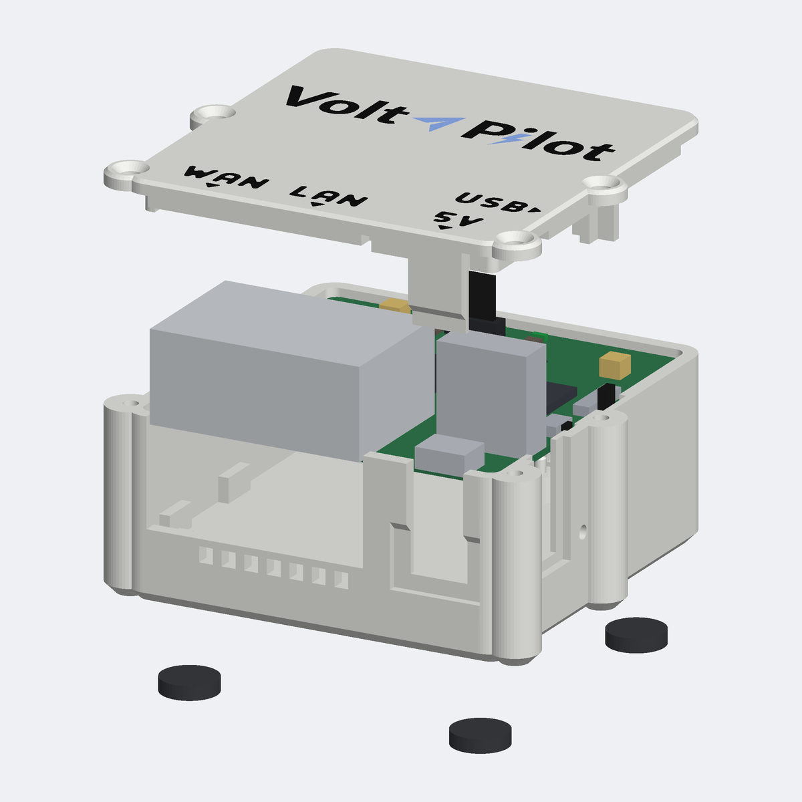
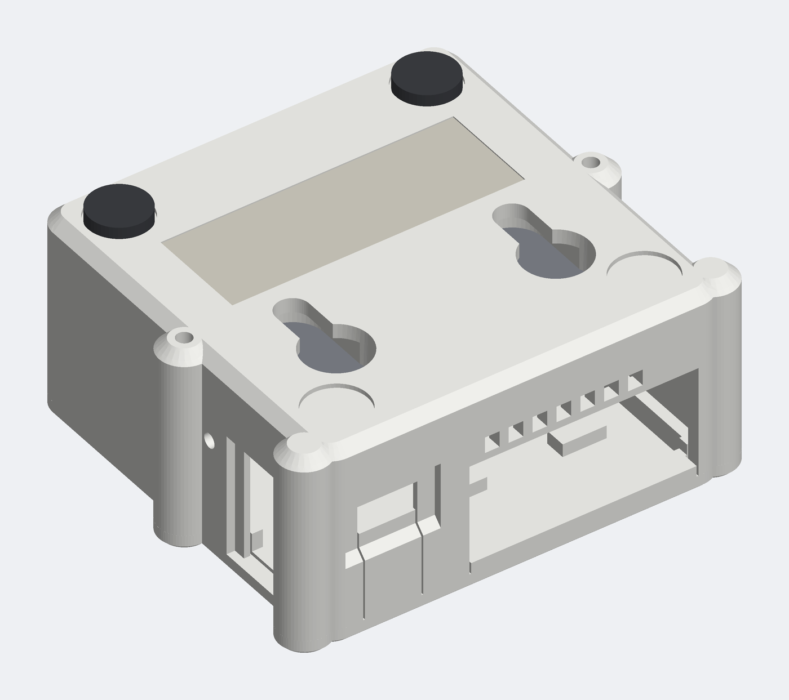

# Gehäuse für das Edge Light auf dem GL.iNet GL-MT300N-V2 („Mango“)

Ein 3D-gedrucktes Gehäuse für die **nackte Platine** des Routers GL.iNet GL-MT300N-V2 („Mango“), auf
dem das VoltPilot Edge Light läuft ([Mango-Notizen](../../docs/mango.md)). Es ersetzt die gelbe
Originalschale: weiß, mit dem VoltPilot-Logo und den Namen der Anschlüsse (WAN, LAN, 5V, USB) bündig
im Deckel eingelegt. Es liegt auf vier Klebefüßen oder hängt an zwei Schrauben in Schlüssellöchern der
Unterseite; ein Clip für die Hutschiene ist Zubehör.

Das Gehäuse ist ein Python-Programm ([build123d](https://github.com/gumyr/build123d)); alle Maße sind
Daten, jede Zahl der Platine trägt ihre Herkunft.

| | |
|---|---|
|  |  |
|  | Außenmaß 55,55 × 55,95 × 27,5 mm, mit den vier Schraubsäulen 62,45 mm breit (Originalschale: 58 × 58 × 25 mm). Die Bilder erzeugt das Programm (`./bauen.sh entwurf`); es sind Zeichnungen des Modells, keine Fotos. |

## Stand

**v0.4, vorerst fertig** (Entscheid des Betreibers vom 12.10.2026: Schrift 3,8 mm, Lage und
Buchstabenformen passen, „damit ist das gehäuse erst mal final“).

| Teil | Stand |
|---|---|
| Unterteil | gedruckt, bestätigt am 11.10.2026 („ich habe das komplette gehäuse v0.2 gedruckt und es sitzt perfekt“); seit dem ersten Druck vom 10.10.2026 unverändert |
| Deckel, Körper mit Lichtschacht | gedruckt, bestätigt am 11.10.2026 („sitzt perfekt. Licht passt auch“) |
| Deckel, Beschriftung 3,8 mm | nach dem Druck gewählt am 12.10.2026 („gedruckt - 1. wir nehmen 3,8 2. ja“; gefragt war nach der Schriftprobe). Ob auch der Deckel selbst in dieser Fassung schon gedruckt ist, ist nicht ausdrücklich gesagt |
| Hutschienen-Clip, Bohrlehre | gerechnet und zur Probe geslict; kein Druck gemeldet |
| Unterteil mit Kennung (Referenz und QR-Code je Box, Entscheid 8 vom 26.10.2026) | gerechnet, zur Probe geslict, QR-Code aus dem G-Code gelesen; **kein Druck gemeldet**. Sonst das bestätigte Unterteil, ohne Etikettfeld ([Kennung](docs/kennung.md)) |

Genauer, je Datei: [druck/README.md](druck/README.md). Was offen ist: [Entscheidungen, Abschnitt „Offen“](docs/entscheidungen.md#offen).
Zu Produktsicherheit und CE trifft dieses Verzeichnis keine Aussage; das klärt der Betreiber selbst.

## Wegweiser

| Ich will … | Datei |
|---|---|
| drucken | [druck/](druck/README.md) (fertige 3MF) und die [Druckanleitung](docs/drucken.md) |
| das Gehäuse einer Box mit Referenz und QR-Code drucken | `./bauen.sh --referenz edge-…`, dann [Kennung](docs/kennung.md) |
| zusammenbauen, aufstellen, an die Wand hängen | [Montage](docs/montage.md) |
| wissen, woher ein Maß kommt und wie sicher es ist | [Maßmodell](docs/massmodell.md), [Tabelle aller Zahlen](docs/massmodell-tabelle.md) |
| wissen, warum etwas so gebaut ist | [Entscheidungen und Geschichte v0 bis v0.4](docs/entscheidungen.md), [Regeln für Druck, Schrift und Logo](docs/regeln.md) |
| das Modell neu bauen oder ändern | [Bauen und ändern](docs/bauen.md) |
| ein Gehäuse für ein anderes Gerät anfangen | [Übersicht der Gehäuse](../README.md#ein-weiteres-gerät-dazunehmen) |

## Aufbau des Ordners

```
glinet-gl-mt300n-v2/
├── README.md              dieser Einstieg
├── druck/                 fertige Druckdateien (3MF) mit Vermerk, was gedruckt und bestätigt ist
├── docs/
│   ├── drucken.md         Drucker, Farben, Lage, Zeiten, Farbwechsel, Abfall
│   ├── montage.md         Zusammenbau, liegend, Wand, Hutschiene, Etikett
│   ├── kennung.md         Referenz und QR-Code je Box auf der Unterseite: Befehl, Lage, Prüfung
│   ├── massmodell.md      Quellen, Bezug, Verfahren; was gemessen, was bestätigt, was angenommen ist
│   ├── massmodell-tabelle.md   jede Zahl mit Herkunft (aus dem Programm erzeugt)
│   ├── entscheidungen.md  Geschichte v0 bis v0.4 mit Datum, offene Punkte
│   ├── regeln.md          Konstruktions- und Druckregeln mit Herkunft
│   ├── bauen.md           einrichten, bauen, prüfen, ändern; Fassungen der Werkzeuge
│   └── bilder/            drei Ansichten aus dem Programm
├── gehaeuse/              das Modell (Python-Paket): Maßmodell, Stellgrößen, Entwurf, Prüfung
├── logo/logo-vektor.svg   das Logo als Vektor; einzige Quelle des Logos für das Modell
├── werkzeug/              Bambu Studio einrichten und aufrufen, Logo nachzeichnen
├── einrichten.sh          legt die Python-Umgebung an (ohne Root-Rechte)
├── bauen.sh               baut und prüft alles nach aus/; --referenz: das Gehäuse einer Box
└── anforderungen.txt      Fassungen der Python-Pakete
```

## Kurz: neu bauen

```bash
./einrichten.sh            # Python-Umgebung in .venv (rund 1,1 GB)
./einrichten.sh --bambu    # dazu Bambu Studio für die Kontrolle der 3MF (rund 0,8 GB)
./bauen.sh                 # alles nach aus/; Rückgabewert 1 bei einem Fehler
./bauen.sh --referenz edge-wrk7abg   # Gehäuse einer Box mit Referenz und QR-Code
```

Der Bau prüft den Entwurf (Durchdringung mit der Platine, Regeln, Stege je Druckschicht, jede 3MF
durch den Slicer) und vergleicht am Ende die eingecheckten Druckdateien mit dem, was er gerade
gebaut hat. Einzelheiten: [Bauen und ändern](docs/bauen.md).
