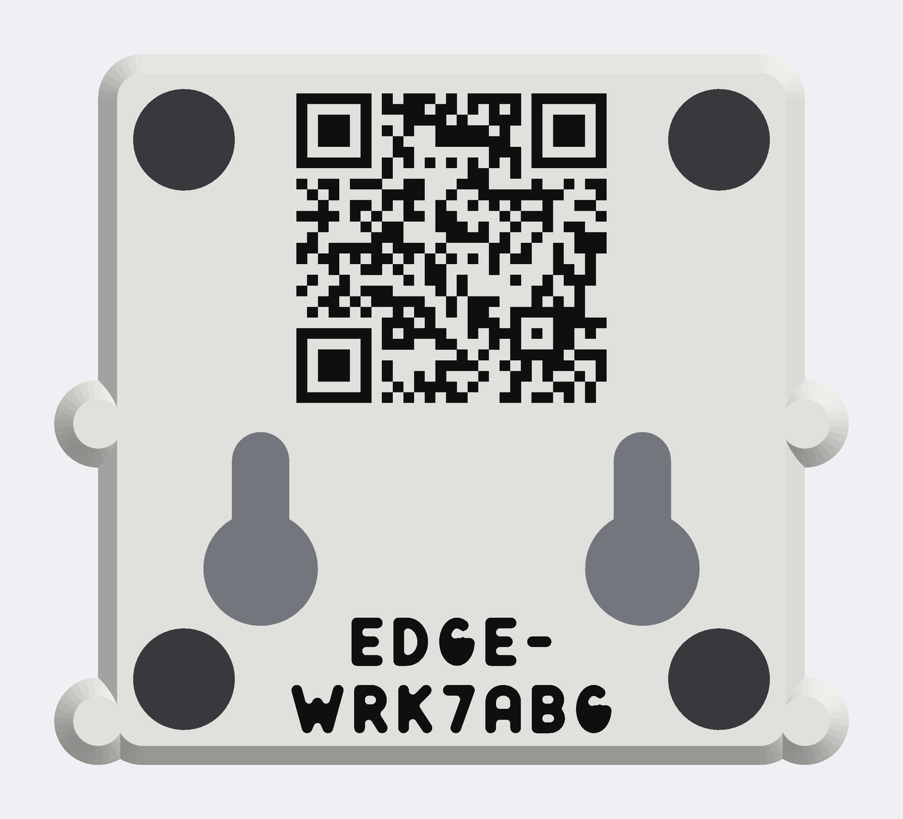

# Kennung auf der Unterseite: Referenz und QR-Code je Box

Entscheid 8 des Betreibers vom 26.10.2026: „ich würde gerne die beschriftung und qr code per
3d-Drucker aufs gehäuse drucken keinen aufkleber mehr zu brauchen“. Jede Box bekommt deshalb ein
eigenes Unterteil: Auf der Standfläche liegen ihre Referenz in Klarschrift und ein QR-Code mit dem
Direktlink ins Portal (`https://portal.voltpilot.de/k/<referenz>`, [Werkstatt](../../../../docs/werkstatt.md)),
schwarz und bündig in den ersten drei Schichten wie Logo und Schrift des Deckels.



Die Zeichnung zeigt die erfundene Referenz `edge-wrk7abg`, mit der jeder Bau die Kennung baut und
prüft. Sie ist eine Zeichnung des Modells, kein Foto; **gedruckt ist noch keine Kennung.**

## Eine Box beschriften

```bash
./bauen.sh --referenz edge-wrk7abg
```

Die Referenz so, wie sie in der Werkstatt-Liste steht (die Werkstatt-Seite nennt den Befehl bei
jeder Box). Eine Referenz mit falschem Prüfzeichen nimmt der Befehl nicht an. Nach rund anderthalb
Minuten liegt unter `aus/kennung/<referenz>/`:

| Datei | was |
|---|---|
| `gehaeuse-<referenz>.3mf` | **das hier drucken:** Unterteil mit Kennung und Deckel auf einer Platte, ein Drucklauf |
| `unterteil-<referenz>.3mf` | nur das Unterteil mit Kennung, wenn ein Deckel schon da ist |
| `pruefung.md` | Bericht: Inhalt, Abstände, Lesbarkeit aus dem G-Code, Zeit und Farbwechsel laut Slicer |
| `unterseite-<referenz>.png` | Zeichnung der Unterseite von unten |
| `*-qr-sicht.png` | die Sichtfläche um den Code, aus dem G-Code gezeichnet |

Rückgabewert 1, wenn eine Prüfung scheitert. Ohne Bambu Studio (`./einrichten.sh --bambu`) entsteht
die Datei auch, der Befehl endet aber mit 1: Die Lesbarkeit ist dann nicht geprüft.

Drucken wie das übrige Gehäuse ([Druckanleitung](drucken.md)): Filament 1 weiß, 2 schwarz,
3 hellblau (nur der Deckel). Das Unterteil liegt mit der Standfläche auf der Platte; die Kennung ist
seine erste Schicht. Die erzeugten Dateien gehören nicht ins Repository (`aus/` ist ausgenommen): Es
gibt sie je Box, und der Befehl baut sie jederzeit gleich wieder.

## Was gedruckt wird

Der Inhalt kommt aus dem Portal, nicht aus diesem Ordner: `beschriftung()` in
`frontend/portal/src/werkstatt.ts` (Klarschrift = Referenz in Großbuchstaben, Link) und der QR-Kodierer
`frontend/portal/src/qrCode.ts` (Byte-Modus, Fehlerkorrektur M, kleinste Fassung, Maske nach den
Strafpunkten des Standards). `gehaeuse/kennung.py` baut denselben Code mit `qrcode` (Python) und
rechnet die Maske so wie das Portal; `qrcode` allein wählte in 188 von 300 zufälligen Referenzen eine
andere Maske. Lesbar wären beide; gedruckt wird aber Modul für Modul, was die Werkstatt-Seite zeigt.
Beide Seiten prüfen sich gegen denselben Vektor, `docs/contracts/werkstatt-beschriftung.json` (Portal:
`werkstatt.test.ts`; Gehäuse: Schritt `pruefung`). Die Referenz prüft `kennung.py` wie
`kennungGueltig` in `edgeRef.ts`, gegen `docs/contracts/edge-ref-vectors.json`.

| | Wert | woher |
|---|---|---|
| QR-Code | Fassung 3, 29 × 29 Module, Fehlerkorrektur M; der Link hat 42 Zeichen | Kodierer des Portals |
| Modul | 0,84 mm (zwei Bahnen, wie jeder farbige Strich), Code 24,36 × 24,36 mm | `qr_modul` |
| Lage des Codes | mittig zwischen den Mulden der LED-Seite, x 13,3 bis 37,66, y 0,6 bis 24,96 (Koordinaten wie im Maßmodell); in y dort, wo der Abstand zum Rand des Teils und zu den Schlüssellöchern am größten ist | `entwurf.kennung_unten` |
| Ruhezone | 3,1 mm = 3,69 Module bis zum nächsten Dunklen (Rand des Teils, Schlüsselloch); ISO/IEC 18004 verlangt 4. Mehr Platz gibt die Unterseite bei 0,84 mm nicht her | Prüfung, Mindestwert `qr_ruhe_min` = 3 |
| Klarschrift | Schrift des Deckels, 3,8 mm, zwei Zeilen: „EDGE-“ zwischen den Schlüssellöchern, darunter der Rest an der Netzwerk-Seite. In einer Zeile wäre sie rund 42 mm breit; zwischen den Mulden sind 33,5 mm frei | `kennung_zeilenabstand` |
| Leserichtung | von unten, Netzwerk-Seite unten, wie der Deckel und wie an der Wand | — |
| Etikettfeld | entfällt auf diesem Unterteil (es lag dort, wo jetzt der Code sitzt) | — |

**Was sich am Unterteil ändert.** Nur die Standfläche: Das Etikettfeld (40 × 14 × 0,2 mm, 112 mm³)
entfällt, und die Kennung ersetzt 0,6 mm Weiß durch Schwarz. Wanne, Aufnahme der Platine, Öffnungen,
Schlüssellöcher, Mulden und Säulen sind dasselbe Teil wie das gedruckte und bestätigte Unterteil;
die Prüfung belegt das über die Volumen (Weiß und Schwarz zusammen = Unterteil ohne Etikettfeld).
`druck/unterteil.3mf` bleibt unverändert.

**Welche Referenz nicht passt.** Die zweite Zeile ist für 20 von rund 887 Millionen möglichen
Referenzen zu breit (fünf und mehr W). Dann bricht der Bau mit „Klarschrift … frei von Fase, Mulden
und Schlüssellöchern“ ab; eine solche Box bräuchte eine andere Lage.

## Wie geprüft wird

Bei jedem `./bauen.sh` für die Probe-Referenz und bei `--referenz` für die eine Box:

- **Inhalt** (Schritt `pruefung`): alle Fälle des Vektors gleich dem Portal, die Referenzen des
  Kennungsvektors wie im Portal gültig oder ungültig.
- **Abstände** (Schritt `pruefung`), am Netz des Unterteils gemessen, nicht aus den Stellgrößen: Code
  ganz auf der ebenen Standfläche, mindestens zwei Bahnen zur Fase, zu Mulden und Löchern; Ruhezone
  mindestens `qr_ruhe_min` Module bis zu einem Loch, einer Mulde (dort klebt ein dunkler Fuß) oder
  dem Rand des Teils; Klarschrift mindestens `beschriftung_frei` (1 mm) von allem und außerhalb der
  Ruhezone; kein Zeichen des Alphabets der Referenzen läuft zu; kein Steg in den Schichten der
  Einlage schmaler als eine Bahn; Schwarz nur in den ersten drei Schichten; die Zeichnung der
  Unterseite von unten liest zxing-cpp als den Link, nicht gespiegelt.
- **Lesbarkeit** (Schritt `bambu`): Bambu Studio slict `unterteil-<referenz>.3mf` und
  `gehaeuse-<referenz>.3mf`. Aus dem G-Code wird die Sichtfläche gezeichnet, jede Bahn der drei
  Schichten der Einlage in ihrer geförderten Breite; die erste Schicht liegt oben, durch ihre Lücken
  sieht man die zweite und dritte. zxing-cpp muss daraus den Link lesen: in voller Auflösung, das
  Grau ohne Kunststoff (Loch, Mulde, neben dem Teil) einmal hell und einmal dunkel, und wie eine
  Kamera mit 8, 5 und 3 Bildpunkten je Modul, unscharf und verrauscht. Jeder Fall muss genau den
  Link liefern. Zum Vergleich wird die erste Schicht allein gelesen; sie entscheidet nicht.
  Außerdem fährt der Slicer jedes Zeichen der Klarschrift als geschlossene Bahn (wie beim Deckel).

Ergebnis für `edge-wrk7abg`: in allen fünf Fällen der richtige Link. Die erste Schicht allein lässt
in einzelnen weißen Modulen Lücken (der Slicer fährt um ein Modul von zwei Bahnen eine Schleife und
lässt die Mitte frei) und liest sich nur in zwei von fünf Fällen; das deckt sich mit der Druckprobe
aus der Werkstatt-PR (#1585). Gegenproben: Mit 0,42 mm je Modul (eine Bahn) liest sich der Code aus dem
G-Code in keinem Fall, mit 1,0 mm stößt er an Fase und Schlüssellöcher (Ruhezone 0,4 Module); beides
meldet der Bau als Fehler.

## Was nur ein Druck zeigt

- Ob ein Telefon den gedruckten Code liest, in welchem Abstand, bei welchem Licht. Die Prüfung ist
  eine Rechnung mit zxing-cpp, keine Kamera; die strukturierte PEI-Platte gibt der Fläche eine raue
  Oberfläche, die im Bild nicht vorkommt.
- Ob die Klarschrift von 3,8 mm auf der rauen Unterseite gut lesbar ist.
- Ob die Ruhezone von 3,7 Modulen reicht, auch mit einem Klebefuß in der Mulde daneben.

Bis zu diesem Probedruck gilt das Unterteil mit Kennung als **nicht bestätigt**, auch wenn alles
darüber das bestätigte Teil ist.
