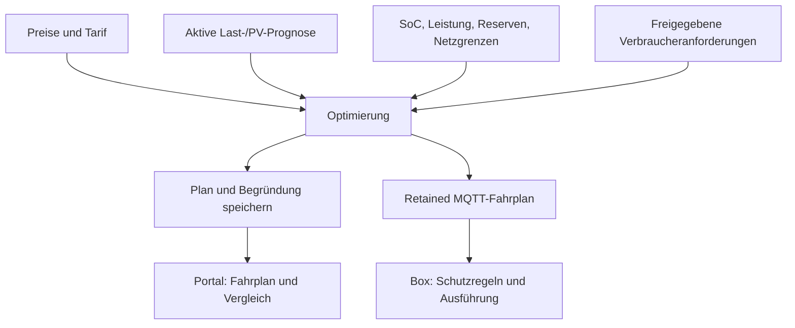

# Optimierung

Der Python-Dienst berechnet wiederkehrend kosten-/erlösorientierte Fahrpläne aus Preisen, Prognosen und Anlagenzustand. Pyomo/HiGHS löst Speicher- und gegebenenfalls Verbraucherplanung; der Go-Core prüft die tatsächliche Ausführung lokal.



## Verhalten

- Rollierender Horizont mit Viertelstunden-Slots; Preisabdeckung kann ihn verkürzen. Unzureichende Eingaben dürfen keinen erfundenen erfolgreichen Plan ergeben.
- Bezug und Einspeisung werden getrennt anhand der vorhandenen Tarif-/Vergütungsdaten bewertet. Verschleiß und Terminalwert fließen in die Optimierung ein.
- Lade-/Entladeleistung, SoC-Band, Reserve und Netzgrenzen begrenzen den Plan. Widersprüchliche gleichzeitige Lade-/Entladeentscheidungen werden verhindert.
- Sonnenstrom-Laden folgt dem aktuellen PV-Bus-Modell: Laden kann bis zur verfügbaren PV-Leistung reichen, während die Last parallel aus dem Netz versorgt wird. Nicht auf die alte reine Überschussformel zurücksetzen.
- Ehrliche Marge (Captain-Entscheid E6 A): an Festpreis-Anlagen muss der Netzanteil einer Ladung (Laden über den PV-Überschuss hinaus, auch über den PV-Bus) nach vollem Rundlauf `FEST_GRID_CHARGE_HURDLE_CT_PER_KWH` (2 ct/kWh) verdienen. Dieselbe Konstante steht im LP (`grid_charge_hurdle`) und in `slot_trim.grid_charge_uneconomic`; nur eine Stelle zu ändern hebt die andere auf. Spot-Anlagen: kein Term.
- Last-/PV-Prognose ist getrennt vom Solver. Die gewählte Modellreihe, Ersatzpfade und der PV-Nowcast werden in `inputs.py` zusammengeführt.
- Live-Eingänge je Box (AP-15 P5): Speicherstand (≤ 120 min), §14a-Vorgabe (≤ 60 min) und Last/PV des laufenden Slots (≤ 30 s) kommen von der Box der geplanten Batterie (`asset.device_id`). Fehlt der Wert dort oder ist er veraltet, gilt er als unbekannt, nie als Wert einer anderen Box. Ohne Box bleibt die Anlagen-Abfrage wortgleich. Rückfall-Historie, PV-Anker, Lastspitze und Nachtfehler sind Anlagen-Größen (nächste Zeile). Nachweis: `tests/test_eingang_je_box.py` (R8).
- Anlagen-Größen einer Mehr-Box-Anlage (AP-15 Folgepunkt, W2, B1): ist die führende Box bestimmt (`site.lead_device_id`, in der Anlage angemeldet, nicht ausgebaut, und mindestens eine weitere Box ist es auch — `load_fuehrende_boxen`, dieselbe Bedingung wie die Rollup-Prozedur der api `V20260922020000`), liest die laufende Lastspitze nur ihre Zeilen (sie liest den Netzzähler), die Rückfall-Historie und der PV-Anker bilden Viertelstunden der ANLAGE (`_anlagen_slot_werte`): PV = Summe der Boxen, Last = Last der führenden Box + je weiterer Box ihr `load_kw − power_kw` (ihre Nettoabgabe, die die führende Box nicht sieht; fehlt dieses Paar einer sendenden Box, ist die Viertelstunde unbekannt). Nachtfehler und abgeschlossene Viertelstunden der Lastspitze lesen das Rollup, das seit `V20260922020000` dasselbe rechnet. Ein-Box-Anlage und Anlage ohne gespeicherte Wahl: Abfragen wortgleich. Nachweis: `tests/test_leser_je_anlage.py`, api `UemsRollupMehrBoxMigrationTest`.
- Planlauf mit Anteilen (AP-15 IP-14, P4, B5, Y4, E7 = A): nur in einer Anlage in `anteile_aktiv` liest `verbund.load_verbund` je mitsteuernder Box ihren Anteil (je Richtung das Kleinere aus quittiertem und gesendetem Dokument), ihren Herzschlag und ihre Verbraucher. Nebenbedingung: PV-Grenze der Box (+ Entladung, wenn der EINE Speicher an ihr hängt, LA1) ≤ Einspeise-Anteil; Verbraucher der Box ≤ Bezugs-Anteil (+ Netzladen des Speichers an ihr). Die führende Box bekommt keine. Stumm (90 s) oder ohne Wert: voller Anteil belegt, ihr Rest geht an niemanden. Die PV einer Box ist ihr kWp-Teil der Anlagen-Prognose. Ohne scharfen Verbund kommt nichts ins Modell (Paarbeweis NW-6). Nachweis: `tests/test_planlauf_anteile.py` (R1, R2, R3, R7).
- Plan je Box (AP-15 IP-15, P1, P2, W8): in `anteile_aktiv` schneidet `publisher_v2.plan_je_box` den EINEN Lauf in je ein Dokument pro steuernder Box (dieselbe `plan_id`/`generated_at`, `lauf_nr`, Block `gemeinsame_steuerung.rolle`); Speicher → Box seines Assets, PV/Verbraucher einer mitsteuernden Box → sie (dieselbe Zuordnung wie ihre Nebenbedingung), Rest → führende; `grid_import_limit_kw` nur bei der führenden. Eine als belegt gerechnete Box (stumm, unbestätigt, ohne `steuerungsverbund_anteil`) bekommt nichts; eine Box ohne Entität bekommt die leere retained Nachricht (Rücknahme, kein „veröffentlicht“). Die scharfe Anlage braucht `VOLTPILOT_V2_PLAN_SITES` nicht. Laufnummer für jeden v2-Lauf in `site_plan_run.lauf_nr` (V20260922000000), gesendet nur in der scharfen Anlage. Ohne sie: Byte für Byte wie vorher. Nachweis: `tests/test_plan_je_box.py`; [Vertrag](../../docs/contracts/v2/mqtt-schedule-2.0.md).
- v1 und v2 verwenden getrennte Publishpfade. v2 plant mehrere Entitäten; Verbraucherplanung benötigt ihre Freigaben. Schattenplanung ist keine physische Ausführung.
- Historische Erlöse werden aus Messwerten ermittelt; der Vergleich im Fahrplan ist ein Planungsergebnis.

## Code finden

| Aufgabe | Quelle |
|---|---|
| Eingaben und Frische | `voltpilot_optimization/inputs.py`, `fallback.py` |
| Tarif und Bewertung | `pricing.py`, `config.py` |
| Solver | `solver.py`, `co_solver.py` |
| Planzeitkorrektur | `nowcast.py` |
| „Sonne + Speicher“: Speicheruntergrenze | `storage_release.py` |
| Speicher vor dem Überschuss-Verbraucher (NS-3 B) | `ueberschuss_verbraucher.py` |
| Messlatte (sturer Speicher), Vorsprung-Budget | `stur.py`, `vorsprung.py` |
| Speicherung / MQTT | `persistence.py`, `publisher.py`, `engine.py` |
| Laufzeit / CLI | `cli.py`, `runtime.py` |

Dateinamen in der Tabelle beziehen sich auf `voltpilot_optimization/`. Verbindliche Defaults stehen im Code und in der Deployment-Konfiguration.

## Start und Tests

```bash
python -m venv .venv
source .venv/bin/activate
pip install -e '.[dev,solver]' -e ../forecast
python -m voltpilot_optimization --help
pytest -m 'not slow'
```

`plan` führt einen Zyklus aus, `serve` den periodischen Betrieb; beide benötigen die konfigurierten Daten-/Brokerzugänge. `pytest` ohne Filter ergänzt die langsamen Szenarien. Im Gesamtstack startet das Profil `optimize` den Dienst.

[Prognosen](../../docs/forecasting.md), [Verbraucher](../../docs/verbrauchssteuerung.md), [Golden-Suite](tests/golden/README.md), [Betriebsvertrag](../../docs/k8s-readiness.md).

## Horizont und kurzfristige Korrektur

`OPTIMIZER_HORIZON_SLOTS` fragt 16–192 Viertelstunden an (Vorgabe 192 = 48 h). Preise und reale Prognosen begrenzen das Ergebnis. `96` stellt den früheren 24-h-Horizont wieder her. `OPTIMIZER_HORIZON_HOURS` wird noch mit Warnung umgerechnet; widersprüchliche Werte werden abgelehnt. MQTT überträgt weiterhin die ersten 24 h.

| Korrektur | Wirkung |
|---|---|
| `load_nowcast.py` | Aktuelle Last verankert Slot 0, Ausblendung über acht Slots |
| `nowcast.py` | Verhältnis aus abgeschlossenen PV-Slots, Ausblendung über acht Slots |
| `pv_nowcast.py` | PV-Mittel der letzten 120 s, jüngster Wert höchstens 30 s alt; Ausblendung über zwei Slots |

Bei Abregelung darf PV-Nowcast die Prognose nur anheben; die Nachtgrenze bleibt wirksam. Schalter: `OPTIMIZER_PV_NOWCAST_ENABLED` (true), `…_DECAY_SLOTS` (2), `…_MAX_AGE_SECONDS` (30), `…_LOOKBACK_SECONDS` (120). Fehler lassen die ursprüngliche Prognose bestehen.

`night_reserve.py` bewertet Energie am ersten PV-Überschussslot nach der Nacht anhand der eigenen historischen Nachtfehler. Das ist ein ökonomischer Wertterm, keine zusätzliche harte SoC-Reserve. Ohne geeignete Daten, Preisdifferenz oder Sonnenaufgang im Horizont entsteht kein Term; `OPTIMIZER_NIGHT_RESERVE_ENABLED=false` schaltet ihn ab. Begründungsfelder: `why_night_reserve_kwh` und `why_night_reserve_q`.

`storage_release.py` rechnet für Anlagen mit einem Ladepunkt auf „Sonne + Speicher“ nach dem Lösen die Speicheruntergrenze je Slot (Rückwärtsrechnung bis zur nächsten Erzeugung, vorsichtige Last/PV aus gemessenen Fehlerquantilen, Reserve je Anlage, Vorgabe 1,0 kWh). Sie verändert weder Zielfunktion noch Slots: Handels-Slots tragen keine Untergrenze, geplante Verkäufe heben sie. Endet der Plan vor der nächsten Erzeugung (vor der Day-Ahead-Veröffentlichung um Mitternacht), läuft die Rechnung über die frische gespeicherte Prognose weiter. Schalter: `OPTIMIZER_STORAGE_RELEASE_ENABLED` (true; ohne Ladepunkt auf der Quelle wirkungslos), `OPTIMIZER_STORAGE_RELEASE_FORECAST_MAX_AGE_MINUTES` (120). Fehler kosten die Freigabe, nie den Plan. Fachregel: [Sonne + Speicher](../../docs/verbrauchssteuerung.md#sonne--speicher).

Den Steuerstand je Speicher liest der Takt einmal aus `device_battery_control` (`inputs.load_battery_controls`, Herzschlag-Block `battery_control`, [Vertrag](../../docs/contracts/speicher-steuerstand.md)). Meldet die Box über `asset.device_id` frisch `beobachtet` oder `not_aus`, steuert VoltPilot den Speicher nicht: `battery_observed` legt Laden und Entladen auf die Eigenverbrauchsbahn des sturen Speichers (`stur.eigenverbrauch_dispatch`, als Bound), ohne Vollmachten und Nacht-Wertfunktion, und `storage_release.py` rechnet die Untergrenze ohne Handelsprüfung und Verkaufsentnahme. Keine, veraltete oder unbekannte Meldung: gesteuert wie bisher. Schalter: `OPTIMIZER_BATTERY_CONTROL_ENABLED` (true), `OPTIMIZER_BATTERY_CONTROL_MAX_AGE_MINUTES` (10). Fachregel: [Fahrplan und Steuerstand](../../docs/verbrauchssteuerung.md#sonne--speicher).

## Morgenüberschuss in Ruhe-Slots (NS-5 B)

**Zwischenlösung bis NS-3 B (Vorrang des Speichers vor dem Überschuss-Verbraucher), danach je Anlage abschalten** – beides zusammen ist im Replay der Oktober-Läufe 3,66 € schlechter als NS-3 B allein (mit dem gebauten NS-3 B 3,63 €). NS-3 B ist gebaut (Abschnitt unten): Wer eine Anlage in `OPTIMIZER_UEBERSCHUSS_VERBRAUCHER_ANLAGEN` einschaltet, nimmt sie aus `OPTIMIZER_MORGEN_UEBERSCHUSS_ANLAGEN` heraus. An Anlagen in `OPTIMIZER_MORGEN_UEBERSCHUSS_ANLAGEN` (kommagetrennte Anlagen-UUIDs; leer = keine, ein ungültiger Eintrag bricht laut ab) bekommt jeder Ruhe-Slot vom Berliner Tagesanfang bis zum ersten Slot, in dem der Plan laden will, die Freigabe `charge_surplus_to_battery` (`slot_trim.morgen_ueberschuss_slots`) – ohne die ökonomische Prüfung und die Exportsperre, die den Morgenüberschuss sonst bewusst ins Netz lassen, damit mittags billiger geladen wird. Ab dem ersten Lade-Slot gilt für den Rest des Tages wieder nur die ökonomische Regel (Halten für den Abendverkauf, Abend). Ob heute schon ein Lade-Slot lief, liest `inputs._heute_geplant_geladen` aus `schedule` (je vergangenem Slot der Lauf, der ihn ausgeführt hat); ein Lesefehler kostet den Lauf die Regel, nie den Plan. Tag ohne Lade-Slot: bis zum letzten Sonnenslot. Bleibt: nur Ruhe-Slots mit Platz in der SoC-Bahn; `OPTIMIZER_SURPLUS_CHARGE_ENABLED=false`, unbekannter Ladestand, nicht gesteuerter und von einer Kundenregel gehaltener Speicher schalten die Regel mit ab; wo sie frei gibt, entfällt `unplanned_load_discharge` (ein Defizit deckt die Box in Ruhe selbst). Sollwerte bleiben unverändert. Grund im Plan-Erklärtext: `slot_flags` enthält `morgen_ueberschuss` („Morgenüberschuss in den Speicher (Zwischenlösung NS-5 B)“), nur wo erst diese Regel frei gibt. Nachweis: `tests/test_morgen_ueberschuss.py`, `tests/test_morgen_ueberschuss_db.py`.

## Speicher vor dem Überschuss-Verbraucher (NS-3 B)

Captain-Entscheid vom 15.10.2026, Bauplan NS-P3b. An Anlagen in `OPTIMIZER_UEBERSCHUSS_VERBRAUCHER_ANLAGEN` (kommagetrennte Anlagen-UUIDs; leer = keine, ein ungültiger Eintrag bricht laut ab) erkennt der Plan einen Verbraucher, der selbst auf null Einspeisung regelt und jeden Überschuss nimmt, den der Speicher nicht hält. In Herzogau sind das Stufen von etwa 12 kW bis 37 kW über 3–5 kW Grundlast. Bisher rechnete der Plan im ersten Slot mit der gemessenen Last samt Verbraucher und plante nur noch „Sonne minus Verbraucher“; die Box trimmte die Ladung auf Sonne minus Last, bis sie einbrach. Die Regel steht in `ueberschuss_verbraucher.py`:

- **Grundlast:** aus `telemetry_rollup_15m` der letzten 7 Tage (abgeschlossene Viertelstunden). Eine Viertelstunde mit dem Kennzeichen zählt nicht mit: Last mindestens 8 kW über der Nachtlast und von der Sonne gedeckt. Ein Lastsprung ohne Sonne (Heizstab am Morgen) bleibt Grundlast. Je Berliner Tageszeit (± 15 min) gilt der Median der übrigen Viertelstunden. Gibt es dafür weniger als drei Werte, schweigt die Regel zu dieser Tageszeit.
- **Erkennung** im Messfenster des Laufs (Last und Sonne der letzten 2 min, höchstens 30 s alt): Die Last liegt mindestens 8 kW über der Grundlast, die Sonne deckt sie (± 1 kW), und die Anlage hat das Kennzeichen in den 7 Tagen mindestens eine Stunde lang gezeigt. Sonst ändert sich nichts.
- **Plan:** Im Sonnenfenster (PV-Prognose über der Grundlast) rechnet der Optimierer mit der Grundlast. Der gemessene Verbraucher wird aus Slot 0 und aus seinem Nachlauf im Last-Nowcast genommen (Abklingen über 8 Slots, nie unter die Grundlast, nie über den Wert von vorher); danach kommt der Sicherheitsaufschlag. Außerhalb des Sonnenfensters und ab Slot 8 bleibt die Last wie heute.
- **Box:** Jeder Slot, der lädt und `charge_from_surplus_only` trägt, bekommt die Last des Plans als `charge_hold_base_load_kw` ([Vertrag](../../docs/contracts/mqtt-schedule.schema.json)). Die Box hält die Ladung dann gegen den Verbraucher und nimmt einen Netzbezug zurück, der 60 s steht ([Edge-Laufzeit](../../docs/edge-runtime.md#schutzgrenzen), `guards/chargehold.go`).
- **Erklärtext:** `slot_flags` enthält `ueberschuss_verbraucher` („Speicher vor Überschuss-Verbraucher: Plan rechnet mit der Grundlast“). Die Grundlast steht als `load_kw` im Slot. Das Log `ueberschuss_verbraucher.erkannt` nennt Grundlast, gemessene Last, Sonne, Verbraucher und Belege.
- **Ohne Schalter** wird nichts gelesen, und der Plan ist byte-identisch. Ein Lesefehler kostet den Lauf die Regel, nie den Plan. Ohne Trim-Pflicht (`OPTIMIZER_SLOT_TRIM_ENABLED=false`, unbekannter Ladestand, nicht gesteuerter oder von einer Kundenregel gehaltener Speicher) gibt es kein Haltefeld.
- **Replay** der Oktober-Läufe 1.–13.10. (gleich großer Vergleich, mit Bestand): +39,01 € statt +32,90 € heute (Variante g: +39,20 €). 13.10. +1,57 € statt −2,00 € (Portal-Messlatte), Ladestand Ende 13.10. 49 statt 5 %, schlechtester Tag −0,37 €. Kein Tag liegt mehr als 0,01 € unter heute. Zusammen mit NS-5 B: 3,63 € weniger.
- **Nachweis:** `tests/test_ueberschuss_verbraucher.py`, `tests/test_contract.py`; Box: `guards/chargehold_test.go`, `agent/surplus_short_consumer_scenario_test.go` (`TestSurplusConsumer*`).

## Garantie: Vorsprung-Budget (NS-2 A)

**Monat und letzte 7 Tage mit Bestand nie tiefer als das Budget unter dem sturen Speicher** (Captain-Entscheid 15.10.2026,
Untersuchung `vp-herzogau-nie-schlechter-k5` §7). Das sind die zwei Zahlen der Kachel „VoltPilot-Steuerung“ (HZ-3 A, faire
Messlatte seit NS-1 A); der Tag selbst ist nicht garantiert – ohne Bestand landet ein Abendverkauf als Gewinn am Verkaufstag
und der Nachkauf als Minus am Folgetag. An Anlagen in `OPTIMIZER_VORSPRUNG_BUDGET_ANLAGEN` (kommagetrennt `<UUID>` = Budget
0 EUR oder `<UUID>=<EUR>`; leer = keine, ein ungültiger Eintrag bricht laut ab) prüft `vorsprung.mit_budget` den FERTIGEN
Plan – nach dem Lösen und nach jeder Regel, die Freigaben stempelt –, Regel aus ist byte-identisch zu vorher.

- **Was geprüft wird:** je Slot, was die Box an den Prognosewerten tatsächlich tut (Sollwert, Vollmachten des Slots,
  Defizit-Deckung der Box), daneben der sture Vergleichsspeicher (`greedy_dispatch`, dieselbe Physik wie die Messlatte).
  Fiele der Vorsprung mit Bestand nach dem Slot unter `-Budget` und fährt der Plan dort anders als stur (> 0,3 kW), fährt
  der Slot stur – sofort laden, sofort decken –, sofern das den Vorsprung besser hält. Ab dem ersten Eingriff führt jeder
  Slot die Ladestands-Bahn seines Sollwerts nach. Egal, welche Regel den Slot gestempelt hat: ein NS-5-B-Ruhe-Slot mit
  Überschuss-Freigabe lädt schon wie stur und bleibt unberührt; ein NS-3-B-Slot rechnet mit der Grundlast, und stur gestellt
  behält er den Grund `ueberschuss_verbraucher` und `charge_hold_base_load_kw` (die Box hält die Ladung gegen den Verbraucher).
- **Erklärung:** ein stur gestellter Slot trägt in `slot_flags` zuerst `vorsprung_aufgebraucht` („fährt stur, Vorsprung
  aufgebraucht“; die Bindungen des gelösten Plans entfallen, nur `ueberschuss_verbraucher` bleibt daneben), Rolle `pv_speichern`/`eigenverbrauch`/`warten` und die Vollmachten, mit denen die Box der GEMESSENEN Sonne
  und Last folgt (`charge_surplus_to_battery` + `charge_from_surplus_only` beim Laden, `cover_load_from_battery` +
  `limit_discharge_to_load` beim Decken), jede nur bei eingeschaltetem Schalter. Je Lauf eine Log-Zeile `vorsprung.budget`.
- **Bewertung des Bestands:** Rückstand mit Bezugspreis × √0,92 (die Bewertung der api, 25 ct → 23,98 ct), Vorsprung mit
  dem Einspeisewert des nächsten 12-Uhr-Slots im Horizont (höchstens der Bewertung, nie unter null) – der geprüfte
  Vorsprung ist nie größer als die Zahl der Kachel.
- **Fenster:** Monat und 7 Tage D−6 … D (das Fenster, das die Kachel morgen zeigt). An jeder Mitternacht des Horizonts fällt
  der älteste Tag heraus, am Monatsersten beginnt der Monat bei 0 und der Vergleich springt auf den echten Stand.
- **Woher die Zahlen kommen:** die api schreibt sie je Anlage alle 5 min in `steuerung_vorsprung`
  (`SteuerungVorsprungLaeufer`, dieselben Zahlen wie die Kachel); `inputs._vorsprung_stand` liest sie nur an eingeschalteten
  Anlagen. [Vertrag](../../docs/contracts/steuerung-vorsprung-v1.md).
- **Kein Budget, kein Eingriff:** keine Zeile, Stand älter als 60 min (`HOECHSTALTER`), Lücke im Fenster (die Kachel hat dort
  keine Zahl), unbekannter Ladestand, nicht gesteuerter oder von einer Kundenregel gehaltener Speicher, Gemeinsame Steuerung.
  Ein Fehler kostet den Lauf die Regel, nie den Plan.
- **Was die Regel nicht abfängt:** Fehler innerhalb einer Viertelstunde (sie entscheidet mit der Prognose), Messlücken und was
  die Box auch stur anders macht als der ideale Vergleich (Abstand beim Decken, Haltezeiten).
- **Replay der Oktober-Läufe 1.–13.10. (Herzogau, gleich großer Vergleich, mit Bestand):** heute +32,90 €, mit Budget 0
  +30,94 € (kostet 1,96 € in 13 Tagen, 15 Eingriffe, schlechtester Tag −1,44 €, Monat und 7 Tage nie tiefer als −0,01 €).
  Das idealisierte `m0+w0` des Berichts (+31,57 €) prüft mit den GEMESSENEN Werten des laufenden Slots; die Regel entscheidet
  vorher mit der Prognose (−0,61 € am 01./03.10.) und bewertet einen Vorsprung vorsichtiger (−0,02 €). Zusammen mit NS-5 B
  +31,58 €, schlechtester Tag −0,37 €. Zusammen mit NS-3 B +36,66 € statt +39,01 € (Bericht `g+m0+w0`: 1,67 € unter `g`),
  schlechtester Tag −0,37 €, 13.10. +2,12 €; den Großteil kostet der 01.10., an dem der Monat ohne Vorsprung beginnt.
  Schalter aus: in allen 1248 Viertelstunden gleich wie heute bzw. wie NS-3 B allein.
- Nachweis: `tests/test_vorsprung_budget.py`, `tests/test_vorsprung_budget_db.py`; api `SteuerungVorsprungTest`,
  `SteuerungTageszahlTest`.
